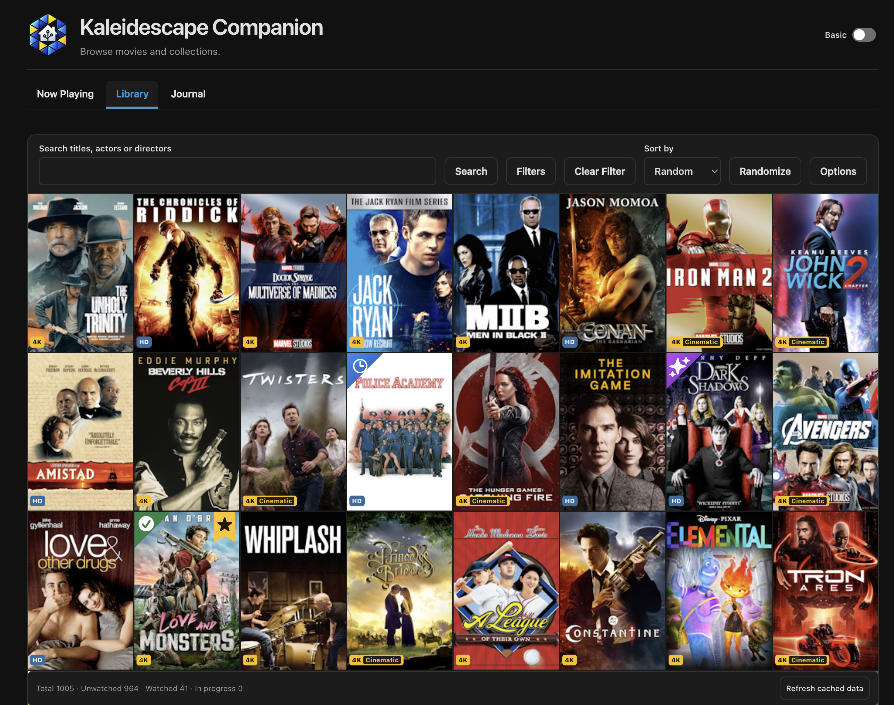

# Kaleidescape Companion

A Home Assistant integration for a household watch Journal, Now Playing and an
optional local movie Library. It observes playback through HA's built-in
**Kaleidescape** integration and offers optional metadata, purchases, calendars
and selected-player controls.

Kaleidescape Companion is an independent, unofficial community project. It is
not affiliated with, endorsed by, or supported by Kaleidescape. Kaleidescape and
related marks are used only to identify intended compatibility and remain the
property of their respective owners.

**Alpha software:** the current candidate is `0.5.0-alpha.1`. It is licensed
under [Apache-2.0](LICENSE). Home Assistant 2026.11.0 is the minimum offered by
Marketplace for this alpha and the development baseline; hardware, restore and
broader compatibility qualification remain open. See the
[roadmap](docs/development/roadmap.md).

[](assets/screenshots/kaleidescape-companion.png)

## Install and try it

You need administrator access to Home Assistant 2026.11.0 or later. Automatic
recording also needs HA's built-in Kaleidescape integration with a media player,
play-status sensor and media-location sensor. Keep that integration installed.
Library and controls are separate opt-in features; controls are not required for
recording.

When the repository is public, add it as a custom integration in Marketplace:

[Open Kaleidescape Companion in your Home Assistant Marketplace](https://my.home-assistant.io/redirect/hacs_repository/?owner=raven42&repository=ha-kaleidescape-companion&category=integration)

1. Back up the target HA configuration and Companion data before an upgrade.
2. Open the link above, add the repository if prompted, enable prereleases and
   install the desired alpha version. Restart HA when prompted.
3. Choose **Settings → Devices & services → Add integration → Kaleidescape
   Companion**.
4. Open **Kaleidescape Companion** in the sidebar. Review Settings before
   enabling features. To record playback, select the three existing entities and
   enable tracking; a qualified completed viewing appears in Journal.

Follow [getting started](docs/getting-started.md) for prerequisites, first use,
upgrade and recovery, including manual installation. Custom-repository and
hardware qualification must be completed before advertising a public alpha.

## Use Companion

- [Configuration and permissions](docs/guides/configuration.md): feature
  opt-ins, household/admin access and personal display profiles.
- [Journal and Library](docs/guides/journal-and-library.md): recording, first
  sync, manual viewings and corrections.
- [Troubleshooting and recovery](docs/guides/troubleshooting.md): diagnostics,
  failed operations and useful support reports.
- [All documentation](docs/README.md): setup and feature references, including
  dashboard cards, metadata, purchases, automations and calendars.

HA users can browse enabled household features. Administrators configure
features and manage private records; Basic/Advanced presentation does not grant
permissions. Recording, collection changes, player controls, experimental title
launch, calendar publishing and external metadata are separately enabled.

## Contribute

Use macOS or Linux with Bash, Python 3.14.2+ (SQLite 3.35+), Node.js 22.13+ on
22.x or 24+, and npm:

```sh
scripts/setup
scripts/build
scripts/check
scripts/package
```

[CONTRIBUTING.md](CONTRIBUTING.md) explains the workflow and links to the
engineering contracts. One checkout contains the sources, tests and pinned pyk
reconstruction inputs. The bundled pyk proof of concept remains until its
upstream and HA compatibility gates pass.

## Security

Custom integrations execute with HA's privileges. Read the
[security guide](docs/development/security.md) for permissions, private data,
logging limitations and reporting. Follow the repository
[security policy](SECURITY.md) for private vulnerability reporting; keep
credentials, household logs and databases out of public issues.

## License

Original Companion code and documentation are licensed under
[Apache-2.0](LICENSE). See [NOTICE](NOTICE) for bundled third-party material and
documentation-asset limitations.
