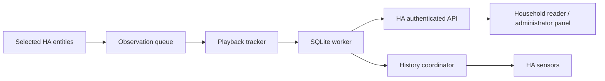

# Technical design

Updated: 2026-10-26. This document describes implemented architecture and explicit
extension points. [Framework status](framework.md) tracks delivery;
[product plan](plan.md) orders future work; [interface research](research.md)
separates evidence from unverified capabilities. The [security policy](security.md)
is authoritative for access, storage, networking, and rendering.

## Runtime and ownership

One custom integration runs inside HA Core and owns one household config entry,
one SQLite dataset, and one bundled Lit panel. Its domain is
`kaleidescape_companion`; the built-in `kaleidescape` integration is preserved.
There is no separate Flask/FastAPI/Django server, authentication system, database
listener, or direct player connection. HA supplies lifecycle, authentication,
entity registries/events, WebSocket commands, HTTP views, and sensors.

The Python project metadata prepares development imports/tools. HA discovers the
runtime directory under its configuration's `custom_components`; pip installation
alone does not install an integration into another HA instance. The compiled
`frontend/panel.js` travels with the Python/JSON runtime package. The standalone
Vite development adapter is excluded from it.

## Source boundaries

Paths below are relative to `custom_components/kaleidescape_companion/` unless
prefixed with `frontend/src/`.

| Files | Responsibility |
| --- | --- |
| `__init__.py`, `runtime.py`, `const.py` | Setup/unload, typed config-entry resources, readiness, dataset resolution, identity/version constants |
| `config_flow.py`, `settings.py`, strings/translations | Single household entry, optional one-player mapping, validated rules, registry-aware references, options reload |
| `configuration.py` | Actor/entry-scoped sidebar adapter to the native HA options flow, with stale configuration rejection |
| `observation.py` | HA state listeners, normalized snapshots, ordered bounded queue, ticks, backup buffering, shutdown |
| `tracker.py` | Deterministic monotonic session state machine; no HA or filesystem dependency |
| `journal.py` | Record/input validation and safe domain errors |
| `repository.py` | Single-worker connection, transactions, CRUD/retry/audit, pagination, consistent exports, private storage lifecycle |
| `recording.py` | Worker-only automatic-session persistence, resume matching, completion, protected correction fields |
| `maintenance.py`, `importing.py` | Worker-only fixed-table inspection/purge and bounded compatible snapshot validation/merge, with durable retry barriers and minimal audit |
| `history.py`, `sensor.py` | Worker-only bounded summary queries; shared HA coordinator and seven translated sensor entities |
| `migrations/` | Ordered schema upgrades, pre-migration snapshots, unsupported-schema rejection |
| `websocket.py`, `http.py`, `security.py` | HA-authenticated commands/downloads, scope/role checks, record projections, filesystem/cancellation protections |
| `panel.py`, `diagnostics.py`, `backup.py` | Bundled static-code registration, redacted health, backup write barriers |
| `frontend/src/api.ts`, `editor.ts` | Typed API transport, exact prepared retries, bounded downloads, correction-form conversion |
| `frontend/src/panel.ts`, `reader.ts`, `now-playing.ts`, `styles.ts` | Administrator editor, household reader, and compact live-context card with shared styling and request invalidation |
| `frontend/src/settings.ts`, `advanced.ts`, `transfers.ts` | Inline native-options form, shared Database toolbar/table tabs/list/detail corrections, transfer/purge dialogs, and exact uncertain retries |
| `frontend/src/dev.ts`, `dev-connection.ts` | Local development authentication/connection shell only |

Future library/artwork/control modules are added with their feature, tests, and
policy changes. Empty reserved implementations and speculative database tables
are deliberately absent. The boundaries above allow those additions without
building another server or moving recording into the frontend.

## Setup, reload, and shutdown

HA config entries own resources through typed `entry.runtime_data`. APIs and
backup hooks resolve those entries; there is no second runtime registry.
Integration-wide API/static registration markers live in `hass.data` because HA
retains those routes across entry reloads. Each handler resolves current readiness
and scope before using storage. Unloaded entries return defined unavailable errors.

Setup opens/migrates the database, optionally starts observation, registers the
panel, and forwards the sensor platform. Setup errors unwind created resources;
storage failure retries via HA's `ConfigEntryNotReady`, while unsupported schema
is a configuration error. Options reload the entry. Entity-registry identities
follow renames; a deleted registered identity must not silently bind to a new
entity with the old name.

The observer subscribes before its initial snapshot and processes all observations
in receipt order. Late/unavailable source entities suspend recording without
preventing manual journal use. Unload first unloads sensor platforms; if that
fails, the runtime remains usable. Successful unload/shutdown rejects new API
work, unsubscribes observation, drains/checkpoints accepted work, closes the
connection on its owning worker, and removes the panel. Removing the entry retains
the database. Tracking disable/player replacement closes the old source session;
ordinary reload/restart preserves recovery evidence.

Follow HA's [runtime-data pattern](https://contributors.home-assistant.io/core/quality-scale/runtime-data/),
[config-entry lifecycle](https://contributors.home-assistant.io/core/integrations/config-entries/),
and [coordinator guidance](https://contributors.home-assistant.io/core/integrations/fetching-data/).

## Journal and storage invariants

The [backend guide](backend.md) defines the implemented schema, API, timing defaults,
resource limits, and restore procedure. Release/API/schema/export versions are
independent: integration `0.0.0`, API `1`, SQLite `5`, JSON export `2`.

- Store durable history in `<HA config>/kaleidescape_companion/journal.sqlite3`,
  separate from Recorder and static web roots. Keep history unless explicitly
  removed by an operator; a visible delete is a retained tombstone.
- Use native `sqlite3` on one dedicated thread for connection creation, migration,
  queries, transactions, snapshots, and close. Never perform database/file work on
  the HA event loop or share this connection across arbitrary executor threads.
- Use rollback-journal mode, full synchronization, foreign keys, parameterized
  values, deterministic ordering, bounded pages, and explicit transactions.
  Keep WAL, FTS, and extra dependencies contingent on measured need.
- Commit manual records, corrections, dataset revision, actor audit, and durable
  request result together. A request UUID binds to its payload/actor; retries
  return the original result. Optimistic viewing revisions prevent lost edits.
- Preserve raw identifiers exactly. Snapshot title/runtime on the viewing; source
  enrichment cannot rewrite recorded facts. Automatic checkpoints respect manual
  corrections and cannot resurrect a deleted viewing.
- Separate playback sessions from household viewings. Partial resume uses the
  same player/exact content identity and a configurable window; a new session
  after completion is a rewatch. Never merge players or editions by title.
- Admit automatic sessions only with a reported runtime at or above the configured
  minimum (10 minutes by default). Unknown runtime waits, 0 disables the filter,
  and excluded playback cannot confirm credits or create another viewing. Preserve
  existing/manual history; changing the rule is not a purge or query filter.
- Measure elapsed watched time monotonically during stable exact `playing` plus
  `content`. Pauses/scans/gaps do not count. Credits provide completion evidence,
  subject to the configured minimum; position is never inferred from watched time.
- Persist semantic edges and absolute checkpoints; restart does not count downtime.
  Overflow or unavailable observations produce gaps. A crash can lose time since
  the last durable checkpoint, not reconstruct playback while HA was stopped.
- Use private files, bounded queues/database/exports, consistent SQLite snapshots,
  and cleanup that finishes accepted work even after cancellation. HA backup hooks
  quiesce writes and buffer bounded source edges. These protections are intentional,
  including their unavoidable filesystem/cancellation latency.

History queries live beside automatic persistence as a worker-only read model.
One `DataUpdateCoordinator` refreshes all enabled history sensors every 30 seconds;
entity getters read memory only. Counts remain exact while title arrays are
bounded by count and encoded byte size. See [sensor semantics](sensors.md).

## API, frontend, and permissions

Use HA's authenticated connection and registered WebSocket schemas for journal
commands. Authenticated HTTP streams private exports; static registration serves
only compiled code. There is no SQL/file/action proxy or unrestricted fetch URL.
The [backend API](backend.md#authenticated-api) is the current contract; future
command names are designed when implemented rather than promised here.

All active users may browse the same household summary. Regular-user records and
metadata use positive field allowlists. Administrators manage records and access
notes, source/session details, health, Now Playing, and exports. Check access
before storage and after awaits; changed roles withhold in-flight results. History
sensors deliberately expose bounded titles/counts through HA entity permissions,
with Recorder/automation retention outside the journal's control.

The administrator editor and household reader remain separate components so
management data/forms cannot accidentally become the reader UI. Both render text
through Lit bindings. Account/connection changes clear cached data and invalidate
late replies. Corrections send only changed fields. An uncertain write preserves
its exact UUID/payload for explicit retry; reconnect does not replay it. Exports
are bounded and aborted on connection changes. Journal lists refresh explicitly;
the administrator Now Playing card polls its small snapshot while visible.

Vite uses a fixed loopback HA target, memory-only credentials, the official HA
WebSocket client, and an export/artwork GET and scoped import POST proxy. Native Python handles storage,
packaging, validation, and deployment; Lit and HA's own schema/client frameworks
serve substantive lifecycle/rendering roles and are retained. Introducing a
second web framework would duplicate HA infrastructure without a current benefit.

## Extension points and constraints

### Lean Now Playing

The existing `now_playing` command reads selected HA states and in-memory tracker
context, without database queries, device connections, or service calls. It checks
administrator status and `POLICY_READ` on each resolved source entity. Additive
fields include a validated friendly name, snapshot receipt time, current session
counted time/credits/gaps, backup pause state, configured minimum runtime and
ignored/waiting reason, and an opaque artwork change key.
The key hashes an HA-local picture reference; its URL/query token is never returned
or persisted. A session is shown only for the current raw content identity.

`now-playing.ts` polls about every five seconds after a request finishes, with no
overlapping refreshes. Hiding/removing the card clears its data, aborts image work,
and invalidates late replies. Authorization errors clear it and stop automatic
retries until explicit refresh, page return, or rebind. Regular readers never mount the card.

Artwork uses authenticated GET `/api/media_player_proxy/media_player.<object_id>`
through HA, with no URL/query supplied by metadata and no copied access token.
The browser accepts JPEG/PNG/WebP, caps accumulation at 5 MiB, budgets five seconds,
and revokes object URLs on replacement/disconnect. Missing/slow art has a placeholder.
No Python image decoder or private artwork cache is introduced. HA owns upstream
image fetching/caching and its native image authorization; see the security policy
for the distinction from Companion's administrator-only snapshot API.

The card deliberately has no transport buttons, seek bar, interpolated progress,
catalog dependency, or separate navigation. Counts describe the current source
session, not the combined viewing or a durable completion verdict. HA's existing
media cards/actions remain available. Future controls reuse those actions.

### Future live updates and multiple players

Keep live state separate from persistent checkpoints. Add snapshot/revision-based,
bounded subscriptions with reconnect resync and access checks on every emission.
Per-player independent state/queues must survive slow library work. Check entity
read permission before sharing live data/artwork. Interpolate progress only with
validated fresh position/timestamp, only during normal playback, clamped to duration;
freeze on pause, scans, gaps, and identity changes.

### Library and artwork

Use HA's managed HTTP session for explicitly configured origins, bounded responses,
timeouts/concurrency, certificate verification, and restricted redirects. Isolate
firmware-dependent HTML parsing from network/lifecycle code; never execute embedded
scripts or call vendor editing routes. Test encoding, escaped metadata, empty
collections, login/error pages, grouped editions, count mismatches, and layout changes.
Choose a maintained structural parser when fixtures justify it.

Introduce source, work/version, exact alias, collection/membership, detail, and
artwork records through migrations. Keep provenance and freshness separate from
viewing facts. Browser groups are source-scoped evidence, not universal film IDs.
A complete staged main-list generation may mark versions unavailable; partial or
failed fetches preserve prior data. Collections synchronize independently. Fetch
details/covers lazily or in small batches so recording stays responsive.

Historical/library artwork belongs in a private bounded evictable cache. Resolve opaque IDs to
backend-owned paths, validate type/size and configured origin, and authenticate
delivery. Never accept an arbitrary path/URL from the panel or serve household
artwork from `www`. Cache eviction cannot remove identities or viewing history.

### Playback, import, and sharing

Use public HA actions and caller context for explicit, permission-checked,
capability-gated controls. Validate fresh identity/expected player revision and
observe the resulting state. Do not retry uncertain/toggle commands blindly.
Selected-title launch/resume/start-over each require proven interfaces; see
[research limitations](research.md). Library synchronization never sends controls.

Broader sharing and import extensions require explicit capability and retention contracts
plus security regressions. Import validates size/schema/paths before transactional
changes. Current administrator purge covers retained sessions/retry content/audit
references, with recording disabled, dataset revisions, explicit confirmation,
and durable content-free retry barriers and maintenance receipts. Keep this
contract when extending retention; external copies are outside live purge scope.
Do not add unused tables, generic repository layers, or alternate authentication
in anticipation of these features.
