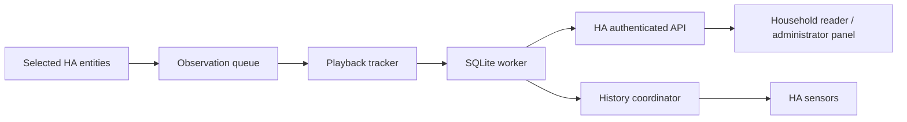

# Technical design

Updated: 2026-10-29. This document describes implemented architecture and
explicit extension points. [Framework status](framework.md) tracks delivery;
[product plan](plan.md) orders future work; [interface research](research.md)
separates evidence from unverified capabilities. The
[security policy](security.md) is authoritative for access, storage, networking,
and rendering.

## Runtime and ownership

One custom integration runs inside HA Core and owns one household config entry,
one SQLite dataset, and one bundled Lit panel. Its domain is
`kaleidescape_companion`; the built-in `kaleidescape` integration is preserved.
There is no separate Flask/FastAPI/Django server, authentication system,
database listener, or direct player control connection. The opt-in library
connector reads a configured local browser origin; it never sends controls. HA
supplies lifecycle, authentication, entity registries/events, WebSocket
commands, HTTP views, and sensors.

The Python project metadata prepares development imports/tools. HA discovers the
runtime directory under its configuration's `custom_components`; pip
installation alone does not install an integration into another HA instance. The
compiled `ui/assets/panel.js` travels with the Python/JSON runtime package. The
standalone Vite development adapter is excluded from it.

## Source boundaries

Runtime paths below are relative to `custom_components/kaleidescape_companion/`.
HA-discovered entry points remain at its root; feature internals are real Python
packages with no compatibility forwarding modules or development tools.

| Files                                                                                                                                                                                | Responsibility                                                                                                                   |
| ------------------------------------------------------------------------------------------------------------------------------------------------------------------------------------ | -------------------------------------------------------------------------------------------------------------------------------- |
| `__init__.py`, `const.py`                                                                                                                                                            | Setup/unload and stable domain/name/version constants                                                                            |
| `config_flow.py`, `backup.py`, `diagnostics.py`, `sensor.py`                                                                                                                         | Required HA configuration, backup, health and sensor entry points                                                                |
| `core/runtime.py`, `core/settings.py`                                                                                                                                                | Typed entry resources, readiness/scope resolution, entity references and shared option validation                                |
| `core/repository.py`                                                                                                                                                                 | Single-worker connection, admission, backup/transfer barriers and asynchronous storage facade                                    |
| `core/journal_store.py`, `core/models.py`                                                                                                                                            | Worker-only journal CRUD/search/retry/audit and shared validation/errors                                                         |
| `core/maintenance.py`, `core/database_schema.py`, `core/database_query.py`, `core/database_mutations.py`, `core/importing.py`, `core/import_merge.py`, `core/migrations/`            | Fixed-table inspection/purge, bounded merge imports and ordered schema upgrades                                                  |
| `core/preferences.py`                                                                                                                                                                | Worker-only personal/shared UI settings, one-time legacy seed and atomic field-patch receipts                                    |
| `playback/manual.py`, `playback/metadata.py`, `playback/repair.py`, `calendar/config.py`, `calendar/store.py`, `calendar/publisher.py`, `calendar/sync.py`, `calendar/sync_store.py` | Exact-version admission, shared observed/manual snapshots, reviewed metadata repair, fixed calendar actions and durable receipts |
| `core/security.py`                                                                                                                                                                   | Shared authorization, private-file and cancellation-cleanup primitives                                                           |
| `playback/observer.py`, `playback/tracker.py`                                                                                                                                        | Ordered HA state observation and deterministic monotonic session state machine                                                   |
| `playback/recording.py`, `playback/history.py`                                                                                                                                       | Worker-only session persistence, resume matching and bounded sensor summaries                                                    |
| `library/config.py`, `library/parser.py`, `library/sync.py`                                                                                                                          | Opt-in configuration, bounded native HTML parsing and serialized catalog/device operations                                       |
| `library/browse.py`, `library/store.py`                                                                                                                                              | Local queries/projections, exact-version persistence and private artwork files                                                   |
| `library/collections.py`, `library/importing.py`, `library/purchases.py`                                                                                                             | Validated collection intents/read-back, portable titles and private purchase history/reviewed associations                       |
| `ui/websocket.py`, `ui/http.py`                                                                                                                                                      | HA-authenticated commands/downloads/uploads and positive reader projections                                                      |
| `ui/settings.py`, `ui/preferences.py`, `ui/panel.py`                                                                                                                                 | Native-options adapter, UI value validation and compiled-panel registration                                                      |
| `ui/assets/panel.js`, strings/translations                                                                                                                                           | Deployed browser module and HA text metadata                                                                                     |

The root `frontend/` Node workspace contains `src/core/` API transport,
`src/ui/` application pages/shared form/dialog/styles, `src/library/` browsing
and collection components, feature-owned Library/Database styles, and
`src/playback/` Now Playing. Its `dev/` holds only the standalone connection
shell, shared exact-route allowlist, local proxy, review fixture and bundle-copy
tool. Tests remain in `frontend/tests/`.

Root `dev/` contains the development launcher, project validator, runtime
packager/deployer, synthetic benchmark and offline purchase-copy helper. Keeping
Node-specific tools beside their workspace avoids custom dependency resolution.
Neither development directory is part of the deployed integration. Runtime
archives and Python package data include the nested compiled asset explicitly.

Future control and richer library modules are added with their feature, tests,
and policy changes. Empty reserved implementations and speculative database
tables are deliberately absent. The boundaries above allow those additions
without building another server or moving recording into the frontend.

## Setup, reload, and shutdown

HA config entries own resources through typed `entry.runtime_data`. APIs and
backup hooks resolve those entries; there is no second runtime registry.
Integration-wide API/static registration markers live in `hass.data` because HA
retains those routes across entry reloads. Each handler resolves current
readiness and scope before using storage. Unloaded entries return defined
unavailable errors.

Setup opens/migrates the database, optionally starts observation, registers the
panel, and forwards the sensor platform. Setup errors unwind created resources;
storage failure retries via HA's `ConfigEntryNotReady`, while unsupported schema
is a configuration error. Options reload the entry. Entity-registry identities
follow renames; a deleted registered identity must not silently bind to a new
entity with the old name.

The observer subscribes before its initial snapshot and processes all
observations in receipt order. Late/unavailable source entities suspend
recording without preventing manual journal use. Unload first unloads sensor
platforms; if that fails, the runtime remains usable. Successful unload/shutdown
rejects new API work, unsubscribes observation, drains/checkpoints accepted
work, closes the connection on its owning worker, and removes the panel.
Removing the entry retains the database. Tracking disable/player replacement
closes the old source session; ordinary reload/restart preserves recovery
evidence.

Follow HA's
[runtime-data pattern](https://contributors.home-assistant.io/core/quality-scale/runtime-data/),
[config-entry lifecycle](https://contributors.home-assistant.io/core/integrations/config-entries/),
and
[coordinator guidance](https://contributors.home-assistant.io/core/integrations/fetching-data/).

## Journal and storage invariants

The [backend guide](backend.md) defines the implemented schema, API, timing
defaults, resource limits, and restore procedure. Release/API/schema/export
versions are independent: integration `0.0.0`, API `1`, SQLite `15`, JSON export
`4`.

- Store durable history in `<HA config>/kaleidescape_companion/journal.sqlite3`,
  separate from Recorder and static web roots. Keep history unless explicitly
  removed by an operator; a visible delete is a retained tombstone.
- Use native `sqlite3` on one dedicated thread for connection creation,
  migration, queries, transactions, snapshots, and close. Never perform
  database/file work on the HA event loop or share this connection across
  arbitrary executor threads.
- Use rollback-journal mode, full synchronization, foreign keys, parameterized
  values, deterministic ordering, bounded pages, and explicit transactions. Keep
  WAL, FTS, and extra dependencies contingent on measured need.
- Commit manual records, corrections, dataset revision, actor audit, and durable
  request result together. A request UUID binds to its payload/actor; retries
  return the original result. Optimistic viewing revisions prevent lost edits.
- Preserve raw identifiers exactly. Snapshot title/runtime on the viewing;
  source enrichment cannot rewrite recorded facts. Automatic checkpoints respect
  manual corrections and cannot resurrect a deleted viewing.
- Separate playback sessions from household viewings. Partial resume uses the
  same player/exact content identity and a configurable window; a new session
  after completion is a rewatch. Never merge players or editions by title.
- Admit automatic sessions only with a reported runtime at or above the
  configured minimum (10 minutes by default). Unknown runtime waits, 0 disables
  the filter, and excluded playback cannot confirm credits or create another
  viewing. Preserve existing/manual history; changing the rule is not a purge or
  query filter.
- Measure elapsed watched time monotonically during stable exact `playing` plus
  `content`. Pauses/scans/gaps do not count. Credits provide completion
  evidence, subject to the configured minimum; position is never inferred from
  watched time.
- Persist semantic edges and absolute checkpoints; restart does not count
  downtime. Overflow or unavailable observations produce gaps. A crash can lose
  time since the last durable checkpoint, not reconstruct playback while HA was
  stopped.
- Use private files, bounded queues/database/exports, consistent SQLite
  snapshots, and cleanup that finishes accepted work even after cancellation. HA
  backup hooks quiesce writes and buffer bounded source edges. These protections
  are intentional, including their unavoidable filesystem/cancellation latency.

History queries live beside automatic persistence as a worker-only read model.
One `DataUpdateCoordinator` refreshes all enabled history sensors every 30
seconds; entity getters read memory only. Counts remain exact while title arrays
are bounded by count and encoded byte size. A second coordinator serves seven
Library/storage sensors using `library/summary.py` and the same worker.
`core/sensor_data.py` owns shared title-list limits. Schema 10 keeps the last
non-empty new-group batch as a bounded snapshot/count/time on the source row,
inside the catalog transaction; it does not add a table or per-title copy. No
entity property performs I/O. Library counts share source grouping and status
precedence with browsing. See [sensor semantics](sensors.md).

## API, frontend, and permissions

Use HA's authenticated connection and registered WebSocket schemas for journal
commands. Authenticated HTTP streams private exports; static registration serves
only compiled code. There is no SQL/file/action proxy or unrestricted fetch URL.
The [backend API](backend.md#authenticated-api) is the current contract; future
command names are designed when implemented rather than promised here.

All active users may browse the same household summary. Regular-user records and
metadata use positive field allowlists. Administrators manage records and access
notes, source/session details, health, Now Playing, and exports. Check access
before storage and after awaits; changed roles withhold in-flight results.
History sensors deliberately expose bounded titles/counts through HA entity
permissions, with Recorder/automation retention outside the journal's control.

The administrator editor and household reader remain separate components so
management data/forms cannot accidentally become the reader UI. Both render text
through Lit bindings. Account/connection changes clear cached data and
invalidate late replies. Corrections send only changed fields. An uncertain
write preserves its exact UUID/payload for explicit retry; reconnect does not
replay it. Exports are bounded and aborted on connection changes. Journal lists
refresh explicitly; the administrator Now Playing card polls its small snapshot
while visible.

Vite uses a fixed loopback HA target, memory-only credentials, the official HA
WebSocket client, and an export/artwork GET and scoped import POST proxy. Native
Python handles storage, packaging, validation, and deployment; Lit and HA's own
schema/client frameworks serve substantive lifecycle/rendering roles and are
retained. Introducing a second web framework would duplicate HA infrastructure
without a current benefit.

## Extension points and constraints

### Lean Now Playing

The existing `now_playing` command reads selected HA states and in-memory
tracker context, without database queries, device connections, or service calls.
It checks administrator status and `POLICY_READ` on each resolved source entity.
Additive fields include a validated friendly name, snapshot receipt time,
current session counted time/credits/gaps, backup pause state, configured
minimum runtime and ignored/waiting reason, and an opaque artwork change key.
The key hashes an HA-local picture reference; its URL/query token is never
returned or persisted. A session is shown only for the current raw content
identity.

`now-playing.ts` polls about every five seconds after a request finishes, with
no overlapping refreshes. Hiding/removing the card clears its data, aborts image
work, and invalidates late replies. Authorization errors clear it and stop
automatic retries until explicit refresh, page return, or rebind. Regular
readers never mount the card.

Artwork uses authenticated GET
`/api/media_player_proxy/media_player.<object_id>` through HA, with no URL/query
supplied by metadata and no copied access token. The browser accepts
JPEG/PNG/WebP, caps accumulation at 5 MiB, budgets five seconds, and revokes
object URLs on replacement/disconnect. Missing/slow art has a placeholder. Now
Playing itself adds no Python image decoder or private artwork cache. HA owns
upstream image fetching/caching and its native image authorization; see the
security policy for the distinction from Companion's administrator-only snapshot
API.

The card deliberately has no transport buttons, seek bar, interpolated progress,
catalog dependency, or separate navigation. Counts describe the current source
session, not the combined viewing or a durable completion verdict. HA's existing
media cards/actions remain available. Future controls reuse those actions.

### Future live updates and multiple players

Keep live state separate from persistent checkpoints. Add
snapshot/revision-based, bounded subscriptions with reconnect resync and access
checks on every emission. Per-player independent state/queues must survive slow
library work. Check entity read permission before sharing live data/artwork.
Interpolate progress only with validated fresh position/timestamp, only during
normal playback, clamped to duration; freeze on pause, scans, gaps, and identity
changes.

### Library and artwork

The implemented [Library slice](library.md) is off by default. Active users can
browse cached metadata/artwork; configuration and manual sync are
administrator-only. It adds a disabled/enabled Library tab, default-host
discovery/override, scheduled catalog/collection/detail sync, first-detected
dates, local filtering, and a private bounded artwork file cache. Shared
browsing provides a resizable cover grid, sortable list, checkbox filter popup
(any within/all across categories), and title-detail modal. Names group before
pagination without merging identities; the modal separately loads bounded
version pages. List reads accept 1–1000 rows (default 50), with compact grouped
summaries and an 8 MiB conservative JSON budget. Cover pagination rounds the
selected target to complete rows, observes the actual grid width, debounces
resize requests, and ignores stale replies. A final catalog remainder is
retained without duplicating entries. Fixed/resizable columns keep sorts from
changing table widths. Hidden collection names affect projection, not source
memberships or status. `frontend/src/library/cover.ts` owns visible-only image
requests and the per-Library concurrency limit. `library/image-cache.ts` owns
private content-keyed object URLs with a 1000-image/128 MiB compressed-byte LRU,
offscreen-first eviction and full Library/account cleanup. Completed images
survive scrolling and view/page changes. Options owns live database-backed
layout toggles; cover format selection and exclusive status/independent Favorite
indicators live in `library/badges.ts`. Metadata uses schema 16 on the existing
worker; a 192 MiB library write ceiling preserves 64 MiB of journal growth.
`ui/preferences.py` validates the native landing default and database UI values;
`core/preferences.py` atomically patches actor-scoped/shared rows on the worker.
`frontend/src/ui/preference-store.ts` handles immediate saves and explicit
failed field retry. Preferences have independent revisions; native options
reload only for environmental settings. `navigation.ts` retains only the
allowlisted main tab in the URL. See [UI preferences](ui-preferences.md) for
limits and badges. Purchase dates are columns on each title version, independent
of first detection and viewing evidence. `core/importing.py` validates portable
snapshots, `library/importing.py` validates exact title-version metadata, and
`core/import_merge.py` owns read-only review plans and transactional
missing-field merges. The one-time HTML parser and corrected-copy helper live
only in `dev/`; see [purchase dates](purchase-dates.md) and
[reviewed imports](imports.md).

Use HA's managed HTTP session for explicitly configured origins, bounded
responses, timeouts/concurrency, certificate verification, and restricted
redirects. Isolate firmware-dependent HTML parsing from network/lifecycle code;
never execute embedded scripts. Only the separate explicit Add to Collection
action may call its fixed verified form route. Test encoding, escaped metadata,
empty collections, login/error pages, grouped editions, count mismatches, and
layout changes. The initial bounded structural parser uses the native HTML
parser and fictional fixtures; introduce an external parser only if future
firmware needs justify it.

Introduce source, work/version, exact alias, collection/membership, detail, and
artwork records through migrations. Keep provenance and freshness separate from
viewing facts. Browser groups are source-scoped evidence, not universal film
IDs. A complete staged main-list generation may mark versions unavailable;
partial or failed fetches preserve prior data. Collections synchronize
independently. Fetch details/covers lazily or in small batches so recording
stays responsive.

Historical/library artwork belongs in a private bounded evictable cache. Resolve
opaque IDs to backend-owned paths, validate type/size and configured origin, and
authenticate delivery. Never accept an arbitrary path/URL from the panel or
serve household artwork from `www`. Cache eviction cannot remove identities or
viewing history.

The separately opted-in [Add to Collection](library-collections.md) uses
`library/collections.py` for fixed-form/hidden-value parsing and schema 8
durable intents, and LibrarySync for serialized preflight/POST/read-back. The
source lock and accepted-task drain coordinate scan, backup, cancellation and
unload. The frontend version dialog sends only opaque IDs, labels, revision and
UUID; checks never repeat a POST. Removal semantics remain unverified and are
not implemented.

### Playback, import, and sharing

Use public HA actions and caller context for explicit, permission-checked,
capability-gated controls. Validate fresh identity/expected player revision and
observe the resulting state. Do not retry uncertain/toggle commands blindly.
Selected-title launch/resume/start-over each require proven interfaces; see
[research limitations](research.md). Library synchronization never sends
controls.

Broader sharing and import extensions require explicit capability and retention
contracts plus security regressions. Import validates size/schema/paths before
transactional changes. Confirmed Database deletion covers supported live rows
and dependent references with content/row snapshot checks and content-free
retry/audit barriers. Active playback rows and integrity metadata stay
protected; recording and sync may remain enabled. The compatibility bulk
viewing-purge API retains its disabled-recording rule and maintenance receipts.
Keep these contracts when extending retention; external copies are outside live
deletion scope. Do not add unused tables, generic repository layers, or
alternate authentication in anticipation of these features.
