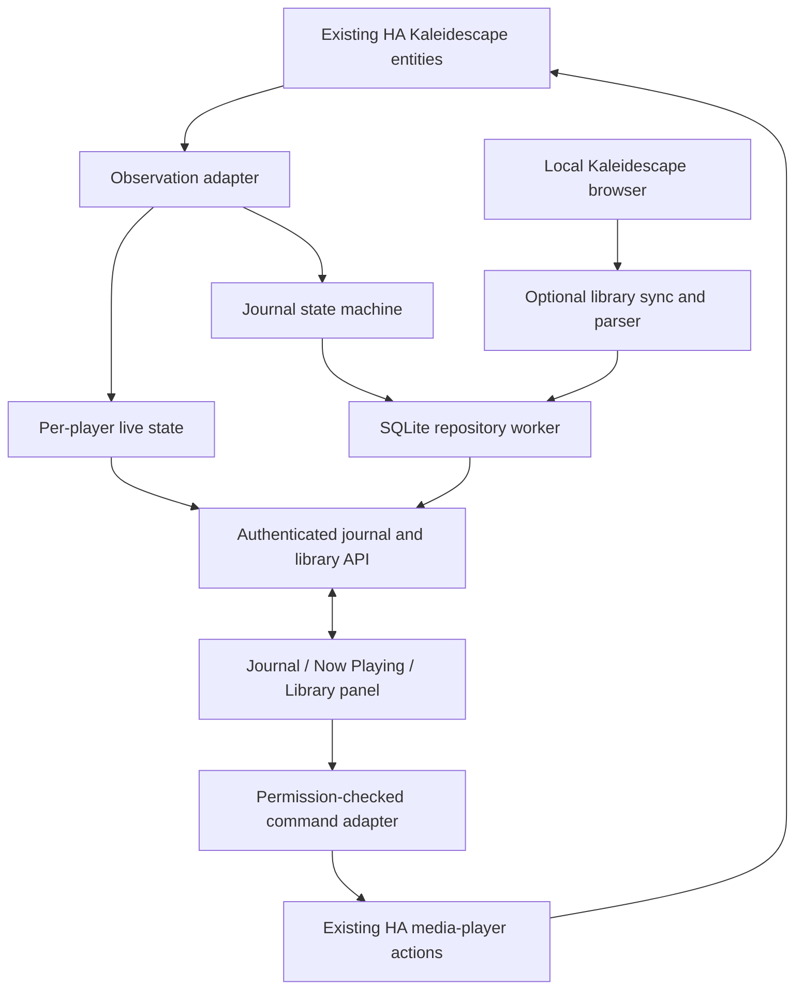

# Kaleidescape — Technical Design

Date: 2026-10-22  
Status: Research-backed design draft; framework scaffold created, feature implementation pending; no device controls performed.  
Companion: [Product plan](plan.md)

## 1. Scope and decisions

Build one custom Home Assistant integration, named **Kaleidescape** (internal domain `kaleidescape_companion`), with a bundled responsive panel. Run locally inside HA, without a required NAS, separate web server, cloud account, automation blueprint, or HA app/add-on.

Delivery order is foundations, watch journal with read-only Now Playing, library browser, playback and controls, then polish. Journal is the default destination; navigation is Journal, Now Playing, Library. Library synchronization and control development must not block recording or browsing viewings.

Decisions proposed by this design:

| Area | Decision |
| --- | --- |
| Playback observation | Subscribe to existing HA entities in process; do not create a WebSocket client back into HA |
| Durable records | Own SQLite database under HA's configuration directory, separate from Recorder |
| Frontend | Bundled TypeScript/Lit custom panel using HA authentication, theme, and connection |
| Panel data | Integration-specific WebSocket commands/subscriptions; authenticated HTTP for images and exports |
| Library | Optional backend HTTP client and isolated HTML parser; local cached queries |
| Controls | Existing HA media-player actions first; additional capabilities require verified interfaces |
| Identity | Preserve raw source handles and explicit aliases; no title-only automatic merges |
| Existing Played labels | Source collection state with unknown historical dates, never invented journal sessions |
| Household model | One shared history; independent sessions per configured player |

All API names prefixed `kaleidescape_companion` below are proposed interfaces, not existing Home Assistant APIs. Defaults and timing values are initial engineering proposals to validate, not established vendor requirements.

## 2. Research method and confidence

Evidence comes from official documentation, upstream source inspection, read-only local HTTP requests, and the entity/automation examples supplied in the conversation. No playback, collection edits, configuration changes, or integration installation was performed.

The local browser pages reference firmware assets `26.1.2-27147`. The source review used Home Assistant Kaleidescape component revision [9337c039ca18](https://github.com/home-assistant/core/tree/9337c039ca181612aa14354f068ea9b42758d8d1/homeassistant/components/kaleidescape), dated October 17, 2026, and Python client [v1.2.0](https://github.com/SteveEasley/pykaleidescape/tree/50df2869349667d1e68d429b9b619e32ede9879b). That component's manifest requires `pykaleidescape==1.2.0`. Some cached web source results showed older versions, so findings use downloaded pinned source where available. The installed HA version and its exact component source have not been inspected; upstream support is not proof of installed behavior.

Other HA interfaces were inspected on the development branch, observed at `19c678c3488473cd271350dcdf9e7268d726bdd0`; frontend types were inspected on its development branch, observed at `7ed6d18b4d6ed5eb176959902bd00e8f18fc2fc7`. Recheck APIs against the chosen supported release before implementation. No minimum HA version is claimed yet.

Confidence labels used below:

- **Observed:** returned by this local server or supplied by the user.
- **Source verified:** present in reviewed implementation or vendor documentation, not exercised on the installation.
- **Proposed:** our implementation choice.
- **Unresolved:** requires more evidence or an authorized device test.

## 3. Available interfaces and findings

### 3.1 Existing HA Kaleidescape integration

The reviewed media-player entity exposes title, content ID, duration, image, position, and position-update timestamp. Its supported controls are power, play, pause, stop, next, and previous. It has neither `async_play_media` nor a `PLAY_MEDIA` capability. Forward and reverse scan are mapped to the generic HA `playing` state. A zero underlying position becomes absent because the implementation uses a truthiness check. Its position timestamp is produced while in a playing/scan state; freshness must be validated on the installed release. [Pinned media-player source](https://github.com/home-assistant/core/blob/9337c039ca181612aa14354f068ea9b42758d8d1/homeassistant/components/kaleidescape/media_player.py)

Dedicated sensors expose raw play status, media location, play speed, and diagnostic video/masking information. Use the first two as the journal's semantic inputs rather than the generic player state alone. [Sensor source](https://github.com/home-assistant/core/blob/9337c039ca181612aa14354f068ea9b42758d8d1/homeassistant/components/kaleidescape/sensor.py)

The remote entity accepts an explicit allowlist of navigation commands; it is not a generic protocol transport. Reading another integration's private runtime objects or calling arbitrary private methods is excluded from the design. [Remote source](https://github.com/home-assistant/core/blob/9337c039ca181612aa14354f068ea9b42758d8d1/homeassistant/components/kaleidescape/remote.py)

Confirmed entity mapping for this household:

| Role | Entity |
| --- | --- |
| Player | `media_player.theater_kaleidescape_theater` |
| Exact playback mode | `sensor.theater_kaleidescape_theater_play_status` |
| Movie location | `sensor.theater_kaleidescape_theater_media_location` |

The user's Turtle Odyssey snapshot supplies raw playback ID `26-0.0-S_c446c8e2`, duration 2,464 seconds, and content type `stream`. Position was not present in that snapshot. Preserve exact seconds for playback; catalog runtime is rounded minutes. Do not filter movies by `media_content_type == movie`.

### 3.2 Local browser interface

Read-only requests on October 22 returned the following. Counts are observations, not constants.

| Route | Observed structure | Intended use |
| --- | --- | --- |
| `/movies` | 845 reported entries; rows with `selection_handle`, `selection_group`, title, genre, rating, director, year, type | Catalog discovery, group/version mapping |
| `/movies?collection=Played&sort=2` | 25 reported entries | Source Played membership |
| `/movies?collection=New&sort=2` | 820 reported entries | Source New membership |
| `/movies?collection=Paused&sort=2` | Empty; count label is `No` | Resume-candidate label only, not a saved position |
| `/details?id=<handle>&callback=true` | Hidden movie/group IDs, details table, title, artwork paths, collection links | Detail enrichment |
| `/KaleidescapeMovies.csv` | Title, Genre, Rating, Lead Actor, Director, Year, Type, Duration (mins) | Optional cross-check/import aid |
| `/webcovers/...jpg`, `/webcoverslarge/...jpg` | Hobbit cover request returned 20,795 bytes | Backend artwork caching |

Sources: [Local library](http://my-kaleidescape.local/movies), [Played](http://my-kaleidescape.local/movies?collection=Played&sort=2), [New](http://my-kaleidescape.local/movies?collection=New&sort=2), [CSV](http://my-kaleidescape.local/KaleidescapeMovies.csv). These links require access to the household LAN.

The Hobbit: An Unexpected Journey is in Played, group `172020140`, with handles `0-S_c41b6bf1`, `0-S_c445a231`, and `0-S_c4609063`. Details include synopsis, cast, director, genres, versions, year, rating, and 182-minute runtime. All three Hobbit titles were present in Played during the prior inspection. [Local Hobbit details](http://my-kaleidescape.local/details?id=0-S_c41b6bf1&callback=true)

Turtle Odyssey's browser handle is `0-S_c446c8e2`, group `412251240`, and its detail page currently lists Played. This provides one candidate relationship to the supplied playback ID; it does not establish a universal ID transformation. [Local Turtle details](http://my-kaleidescape.local/details?id=0-S_c446c8e2&callback=true)

The pages declare ISO-8859-1 and contain HTML-escaped attributes plus embedded version metadata. Membership controls make Played/New editable labels. The CSV lacks identifiers and memberships, so it cannot be the sole catalog source. The response has no-cache headers and framing restrictions allowing the server itself and Kaleidescape domains; use our own panel rather than embedding the vendor page.

The browser JavaScript also references `user/library_updater` for individual row updates. It was inspected, not called, and is not selected as a dependency: a UI-specific updater is not evidence of a stable bulk API. Initial catalog synchronization uses the verified page routes.

Only the observed local/downloaded library is in scope. Do not equate it with every purchase or all cloud-owned titles. Password-protected browser configurations and other firmware remain untested.

### 3.3 Vendor protocol and Python client

The published text protocol uses TCP port 10000. `GET_PLAY_STATUS` reports mode, duration, title position, and chapter data; `GET_MOVIE_LOCATION` distinguishes content, intermission, and credits. Content can include extras or menus. `GET_CONTENT_DETAILS` retrieves metadata. `PLAY` acts on current/highlighted content and can resume stopped material; it does not take a movie handle. `PERFORM_ACTION` explicitly supports music handles, not movies. No general movie-by-handle launch, saved-offset query, or dated viewing-history endpoint was identified. These are documentation findings, not proof no partner/private interface exists. [Control Protocol Reference Manual, rev. 17, pp. 95–100, 105–114, 150, 172–173](https://www.kaleidescape.com/wp-content/uploads/Kaleidescape-System-Control-Protocol-Reference-Manual.pdf)

The client exposes transport/navigation operations and `get_content_details(handle, passcode=None)`. It parses playback position and rich metadata, but reviewed public methods do not supply arbitrary movie launch or an independent library/history API. Reusing private methods would create unsupported coupling. [Pinned Python device source](https://github.com/SteveEasley/pykaleidescape/blob/50df2869349667d1e68d429b9b619e32ede9879b/kaleidescape/device.py), [message parsing](https://github.com/SteveEasley/pykaleidescape/blob/50df2869349667d1e68d429b9b619e32ede9879b/kaleidescape/message.py)

### 3.4 Capability matrix

| Feature | Evidence | Design consequence |
| --- | --- | --- |
| Record content/credits transitions | User automation + HA sensor source | Phase 2 foundation |
| Read-only current title/status | User snapshot + HA source | Phase 2 Now Playing |
| Show position | Upstream implementation exists; installed behavior unknown | Optional, validated capability |
| Catalog and Played/New labels | Local HTML observed | Phase 3 parser adapter |
| Pause/resume active movie/stop | HA transport methods present | Phase 4, capability and state checked |
| Launch a selected library movie | No verified public route | Separate Phase 4 gate; UI stays unavailable until proven |
| Resume a selected stopped library title | Selection and saved-resume semantics unresolved | Separate gate from resuming the active paused movie |
| Seek/start over | Not exposed by reviewed HA entity | Unsupported unless a verified interface is added |
| Historical viewing dates/counts | Not observed | No historical reconstruction promises |

## 4. Runtime architecture



Proposed modules are `config_flow.py`, `runtime.py`, `observation.py`, `journal.py`, `repository.py`, `websocket.py`, `http.py`, `panel.py`, `sensor.py`, `diagnostics.py`, and `backup.py`. Add `library_client.py`, `library_parser.py`, `library_sync.py`, `artwork.py`, and `controls.py` with later phases. Place compiled panel assets in `frontend/` within the integration package. Keep protocol/HTTP parsing independent of HA lifecycle code so fixtures can exercise it without a running house.

One household config entry owns the database, panel, journal, optional server configuration, and player mappings. Start with one system and one player, but use source/player IDs in records from day one. Permit additional players through options without changing household ownership or duplicating journal databases.

### Setup and lifecycle

Use HA config entries and a UI config flow. Keep typed runtime resources in `entry.runtime_data`; register listener cleanup with `entry.async_on_unload`. HA documents these patterns and supports entry unloading. [Config-entry lifecycle](https://developers.home-assistant.io/docs/config_entries_index/), [config flow](https://developers.home-assistant.io/docs/config_entries_config_flow_handler/)

At setup, open/migrate storage, attach state listeners, then read and reconcile current states through the same per-player queue. This avoids missing a transition between initial read and subscription. Wait for source entities to be ready rather than creating an empty session from unavailable startup states. Register global API/panel resources once; unloaded handlers must return a defined unavailable error instead of accessing closed resources.

The setup flow selects the three entities and records registry identities where available, allowing names to change. Reject duplicate player mappings and mapping one sensor set to two players. An offline configured player may leave the journal browsable with recording suspended. Library host configuration is optional and added in Phase 3; network or parser failures must not fail journal startup.

At unload/shutdown, stop accepting commands, cancel sync, unsubscribe listeners, flush accepted journal changes, close database connections on their owning worker, and release the panel when appropriate. A pending control must become canceled/unknown, never success by shutdown alone.

## 5. Observation and watch journal

### Observation adapter

Use `async_track_state_change_event` for selected entities, capturing attribute changes as well as state changes. This is an in-process listener, not the external WebSocket API. HA supplies a helper for entity-filtered callbacks and unload cleanup. [Event helper documentation](https://developers.home-assistant.io/docs/integration_listen_events/)

Normalize each update into player ID, raw content ID, title, raw play status, location, duration, optional position/timestamp, availability, UTC observation time, and monotonic receipt time. Keep each entity's observation separately because updates are not atomic. Treat `forward`/`reverse`, intermission, and menus as non-counting states. A generic player `playing` value is insufficient to count viewing time.

Process updates sequentially per player. Settle identity transitions over a short proposed 500 ms window, while retaining pause/stop/credits edge times. A debouncer must not discard a brief pause or credit event, or count across it. Cache the old session identity when metadata disappears. Do not attach credits to a newly arriving title until identity and event ordering are consistent; uncertain evidence stays unresolved for correction.

### Session rules

Separate an active playback session from a household viewing. One viewing can contain multiple sessions resumed over time; each session belongs to one player. Simultaneous players never automatically share an active viewing, even for the same movie.

| Observation | Action |
| --- | --- |
| Valid identity + exact status playing + location content | Open/resume session and count from observed start |
| Paused, scanning, intermission, disc menu | Close the counting segment, retain session |
| Credits for the established movie | Record credits evidence; complete once if threshold passes |
| Location none / confirmed stop | Freeze timing immediately; finalize session after proposed 2-second transition grace |
| Movie identity changes | Close prior session and establish next identity independently |
| Unknown/unavailable | Suspend timing, record observation gap, preserve recoverable state |
| Restart | Restore checkpoint, reconcile current identity, never add unobserved downtime |

Proposed completion rule: credits observed for the same established viewing and at least 300 seconds of counted main-content playback. Keep credits evidence even if the threshold fails; provide a manual correction. Store the rule version and completion reason. This threshold is configurable and does not prove full-film coverage. No automatic percentage-based completion is enabled initially.

Completion and playback state are separate: the session may remain active during credits or post-credit content. Repeated credits, seeking backward, and returning to main content must not create a new rewatch until a new session is established. Journal completion never sends controls or changes vendor collections.

Proposed partial-resume policy: attach a new session to the latest incomplete viewing for the same player and exact version identity within 24 hours. If identity is ambiguous or multiple candidates exist, create a separate partial and offer a manual merge. Make the time window configurable. Later position evidence may refine the decision; source Paused membership alone is insufficient. A completed viewing followed by a genuine new session creates a rewatch.

### Time and recovery

Measure counted elapsed time with a monotonic clock during the process lifetime. Persist UTC timestamps for display and ordering. Sum main-content playing segments; never infer seek offsets from elapsed watched time. Position is optional evidence for UI and future coverage analysis, not the initial completion metric.

Persist on semantic transitions and every proposed 30 seconds during counted playback. Write absolute accumulated totals and a monotonically increasing session revision in the same transaction, not retryable increments. A crash can lose up to one checkpoint interval of elapsed time; mark the recovery gap and do not fill it by assumption. On a clean restart same-identity playback may continue the viewing from reconciliation time. Boot identifiers prevent comparing monotonic times from different processes.

Keep short/demo sessions but allow users to hide or ignore them. Corrections must be durable and must not be overwritten by a later source update or repeated credits event. Manual deletion uses a tombstone/recorded decision so an already processed observation is not replayed into a new entry. A genuinely later session can still create a new viewing.

## 6. Persistence and data model

Proposed path: `hass.config.path("kaleidescape_companion", "journal.sqlite3")`. Artwork lives under a sibling cache directory. Create these paths on the HA host, not the client workspace, when implementation is authorized. `/data` belongs to an app/add-on and is not selected here.

Use Python's `sqlite3` through a dedicated single-thread worker: create, query, migrate, back up, and close each connection on that worker. Async callers enqueue work and await results. Never share a thread-affine connection across arbitrary HA executor threads. Keep library batches small and allow journal transitions to run ahead of background enrichment. The HA event loop must not perform SQLite, file I/O, image processing, or substantial HTML parsing. [Python SQLite API](https://docs.python.org/3/library/sqlite3.html), [HA blocking-operation guidance](https://developers.home-assistant.io/docs/asyncio_blocking_operations/)

Start with rollback-journal mode, foreign keys enabled, explicit transactions, and bounded busy timeout. Use WAL only if measurement justifies the extra checkpoint/backup complexity. SQLite documents the journal modes; this selection is our simplification for a modest, serialized workload. [SQLite pragmas](https://www.sqlite.org/pragma.html#pragma_journal_mode)

Proposed logical tables:

| Table | Important fields and constraints |
| --- | --- |
| `schema_metadata` | Schema version, dataset UUID, migration timestamps |
| `sources` | Local source UUID, configured identity, last sync/error; address is not its primary key |
| `players` | Stable local ID, source ID, entity registry mappings, display name |
| `works` | Local work ID, title, year; can exist before catalog sync |
| `versions` | Work ID, source ID, browser handle/group, quality/edition, runtime, availability; unique source + browser handle when present |
| `identity_aliases` | Source/player scope, identifier type, exact raw identifier, version ID, evidence/confidence; prevent ambiguous aliases |
| `viewings` | UUID, work/version reference, start/last-play/completion times, status, completion reason, rule version, manual overrides, revision |
| `sessions` | UUID, viewing/player IDs, raw identity, cumulative seconds, checkpoint, boot ID, revision, ended reason, uncertainty flags |
| `segments` | Session ID, start/end, countable state, duration, optional position endpoints; no row every second |
| `collections` / `memberships` | Source collection identity, group/version scope, observed membership and generation |
| `details` / `artwork` | Field provenance/freshness, cache key, source reference, byte size, last access |
| `changes` | Ordered dataset revision, record ID/type; invalidation and optional bounded audit |

Store source metadata and manual fields separately. Retain original title/duration snapshots on viewings so future metadata changes do not rewrite history. Use source-scoped group IDs as browsing groups; they are not proven global film IDs or edition boundaries.

Initial indexes cover viewing start/completion, version/player sessions, raw identity aliases, normalized title/year, collection memberships, format, and last-watched aggregates. For the observed library size, bounded normalized substring search is sufficient initially; add FTS only after checking availability and measuring need. Whitelist SQL sort keys, bind values, and apply deterministic ID tie-breakers.

Journal data has no automatic age purge. Raw debug observations, if enabled, have bounded retention. Artwork is evictable; identities and viewings are not. Do not write the journal into a sensor attribute or use Recorder as primary storage; Recorder's raw history is subject to retention. [Recorder documentation](https://www.home-assistant.io/integrations/recorder/)

### Backups and migrations

HA provides `async_pre_backup` and `async_post_backup` hooks through an integration `backup.py` platform. Use these to finish accepted transactions and quiesce storage during backup; buffer bounded incoming transitions and process them in order after reopening. Surface overflow/gaps rather than silently asserting complete history. Verify hook discovery, backup-failure cleanup, and bounded buffering on the supported HA version. [HA backup hooks](https://developers.home-assistant.io/docs/core/platform/backup/)

Use SQLite's consistent backup API for downloadable database snapshots and pre-migration copies rather than copying a live database file. Include a versioned JSON export for portability. Raw filesystem snapshots taken without coordination are not a promised consistent export. [SQLite backup API](https://www.sqlite.org/backup.html)

Migrations are ordered and transactional where possible. Reject a newer unsupported schema without deleting data. A failed migration leaves the previous database and an actionable repair state. Test backup restoration with active and completed sessions. Removing configuration retains data by default; provide an explicit admin purge/export flow and a way to reattach retained data on reinstall.

## 7. Read-only Now Playing

Ship in Phase 2 alongside the watch journal, before the library browser. Read normalized live state from existing entities and optionally enrich it from locally available records. Missing catalog records must never hide the current movie.

Show selected player, title, artwork where authorized and available, duration, exact playback mode, content/credits/intermission location, and connection status. Multiple players have separate cards; selecting one changes the view, not playback. Distinguish currently paused playback from a stopped title in the source Paused collection.

If position and its timestamp pass validation, interpolate only during normal playback, clamp within duration, freeze on pause, and reset interpolation on discontinuity, identity change, or stale data. Do not interpolate scans at normal speed. If zero is omitted by the source, show unknown rather than inventing a positive position. A changing HA timestamp does not by itself prove a fresh physical-player position.

Read-only Now Playing contains no transport controls until Phase 4. Small current-movie summaries may link to it from Journal without becoming a library dependency.

## 8. Library synchronization and identity

### HTTP client and parsing contract

Use HA's managed `aiohttp` session for ordinary unauthenticated requests. If the server requires stateful login, implement an isolated authenticated session and documented login flow after inspecting that configuration; do not share login cookies across integrations. Config-flow validation checks a recognizable library page, not just HTTP 200. A login page, error template, or unrecognized document must not be accepted as an empty library.

Parse HTML using a maintained parser dependency; do not execute embedded JavaScript. Respect declared charset and decode HTML entities before parsing embedded JSON attributes. Parse rows structurally and ignore indentation-only variant rows as top-level works while preserving the associated version handles. Treat the display count as a sanity check, not the sole record count or always-numeric field. Support the observed empty `No` collection label.

Use only explicitly selected read routes. The parser must not invoke form posts, edit/delete endpoints, collection modifications, or script callbacks merely because their names or data appear in HTML. If variant information is embedded in an action attribute, read only the data structure; never execute its action.

### Sync algorithm

1. Fetch the all-movies page, parse and validate it into staging objects.
2. Fetch supported collection lists independently. A failed collection fetch preserves its previous membership and marks it stale; it does not clear it.
3. Validate group/version consistency and stage a new generation. Commit catalog changes atomically after a successful complete main listing.
4. Mark absent versions unavailable only after a complete validated listing, preserving journal links. Confirm large unexpected reductions before sweeping availability.
5. Fetch details and covers lazily for visible/current titles, then enrich in small background batches.
6. Publish lightweight invalidation messages after committed changes. Do not push the whole library to every panel.

Proposed defaults: main/collection refresh every 30 minutes, details refreshed after seven days or on demand, two concurrent requests per server, 10-second request timeout, manual refresh debounced, and retry backoff from one to 30 minutes with jitter. Tune against actual hardware and firmware. Source pages advertise no-cache; our persistent cache is application-owned and explicitly timestamped.

A server outage leaves catalog browsing and journal operation available with stale indicators. Store metadata freshness independently of current player availability. No catalog refresh runs in an entity-property getter or blocks panel startup. Broad details/covers warming is optional, so a first import need not issue 845 detail requests immediately.

### Mapping playback to catalog

Always store the exact raw HA playback ID. Use exact known aliases first. The Turtle sample suggests a relationship between `26-0.0-S_c446c8e2` and `0-S_c446c8e2`, but a suffix resemblance is only candidate evidence. Confirm multiple samples across players and versions before introducing a documented normalizer. Disambiguate candidates within the configured source and retain match provenance.

Until matched, record the viewing against a provisional local movie/version. Later enrichment links it without rewriting its viewing facts. Do not merge by title alone, collapse editions automatically, or send a derived handle to a player before control validation. Source Played/New membership should retain group-level scope if the page does not establish per-version scope.

## 9. Panel, APIs, and authorization

### Custom panel

Register a bundled custom element through `panel_custom.async_register_panel`. HA passes `hass`, `narrow`, `route`, and panel configuration, supporting navigation and mobile layouts. These extension points are available, but their Python signatures must be tested against the supported release. [Custom panels](https://developers.home-assistant.io/docs/frontend/custom-ui/creating-custom-panels/)

Proposed routes are `/kaleidescape/journal`, `/now-playing`, and `/library` beneath the panel prefix; the prefix alone opens Journal. Use deep links for movie/viewing details and preserve filters when returning. Build a header, mobile sidebar opener, keyboard navigation, loading/empty/error states, and HA theme variables. Use semantic controls and render metadata as text, not trusted HTML.

Bundle compiled assets inside the integration and register versioned static resources with `hass.http.async_register_static_paths`. Only code and non-private placeholders may be static; journal data and cached household artwork remain behind authenticated routes. Do not copy private data into `/config/www`. [HTTP server source](https://github.com/home-assistant/core/blob/19c678c3488473cd271350dcdf9e7268d726bdd0/homeassistant/components/http/server.py)

### Proposed WebSocket API

Use HA's existing connection from `hass.callWS` and a subscription helper. Implement commands with HA's `websocket_api` registration, schema validation, response/error helpers, and explicit subscription cleanup. HA supports authenticated custom commands and subscriptions; our command vocabulary is below. [WebSocket API](https://developers.home-assistant.io/docs/api/websocket/), [frontend data layer](https://contributors.home-assistant.io/frontend/architecture/data/)

| Proposed command | Contract |
| --- | --- |
| `kaleidescape_companion/info` | API/schema version, dataset ID, feature flags, player capabilities, permissions, health |
| `kaleidescape_companion/journal/list` | Query/filter/sort + page size/cursor; returns viewings and next cursor |
| `kaleidescape_companion/journal/get` | Viewing ID; returns details, sessions, evidence, and revision |
| `kaleidescape_companion/journal/update` | ID + expected revision + allowed patch + request UUID; returns new revision |
| `kaleidescape_companion/journal/delete` | ID + expected revision + request UUID; records deletion decision |
| `kaleidescape_companion/now_playing` | Snapshot for authorized configured players |
| `kaleidescape_companion/subscribe` | Initial snapshot and changes for permitted journal/live/library topics |
| `kaleidescape_companion/library/list` | Search, filters, enumerated sort, page size/cursor; cached query only |
| `kaleidescape_companion/library/get` | Work/version ID; cached details plus freshness/pending enrichment |
| `kaleidescape_companion/library/refresh` | Starts/coalesces background refresh; returns job ID |
| `kaleidescape_companion/control` | Phase 4 action, target player, optional version ID, expected player revision, request UUID |

All commands require dataset/config scope and schema validation. Default page size is 50, maximum 100. Cursors bind to sort/filter and generation; if the generation changes, return a defined refresh-required response. Journal edits use optimistic concurrency and conflict responses instead of silently overwriting another browser's correction. Request UUIDs deduplicate retried writes; control requests are never blindly resent after a timeout.

Subscriptions include a snapshot and revision, followed by ordered bounded changes. Reconnect fetches a fresh snapshot and invalidates stale queries; no promise of replaying an unlimited stream. Unsubscribe on panel disconnect and integration unload. High-frequency position updates can remain in live memory; they do not become one database write per second.

Proposed errors include `not_ready`, `not_found`, `invalid_request`, `conflict`, `unsupported_capability`, `source_unavailable`, and `command_unconfirmed`. Do not return a success result for an operation merely accepted by a task queue; distinguish accepted, executed, and observed outcomes.

### HTTP artwork and export

Proposed authenticated routes:

- `GET /api/kaleidescape_companion/{dataset_id}/artwork/{artwork_id}`
- `GET /api/kaleidescape_companion/{dataset_id}/export?format=json`
- `GET /api/kaleidescape_companion/{dataset_id}/export?format=sqlite`

Use a `HomeAssistantView` with authentication and an explicit dataset-access check. The panel can fetch images using `hass.fetchWithAuth`, convert the response to a Blob URL, and revoke it when no longer needed. Plain image tags do not add bearer authentication automatically. Paginate/stream exports or create a consistent snapshot on the worker; do not base64-encode the database in a WebSocket message. The frontend exposes authenticated-fetch and raw response methods. [Frontend types](https://github.com/home-assistant/frontend/blob/7ed6d18b4d6ed5eb176959902bd00e8f18fc2fc7/src/types.ts), [HTTP view source](https://github.com/home-assistant/core/blob/19c678c3488473cd271350dcdf9e7268d726bdd0/homeassistant/helpers/http.py)

Artwork IDs resolve to backend-owned records, not arbitrary paths or URLs from the browser. Accept bounded JPEG/PNG/WebP content from configured server paths, verify type/size, and use cached IDs. No browser request needs the server's internal address or a temporary HA media-proxy token. For Phase 2, use authorized existing entity artwork when available; historical artwork may show a placeholder until library enrichment exists. Proposed cache ceiling is 250 MB with LRU eviction; test image-processing work off the event loop.

### Permission model

Default the shared household dataset to authenticated, non-guest HA users explicitly allowed by integration options. Administrators manage sharing and sources; initial installation may default to admins until access is configured. Journal corrections require allowed editor access; source configuration and bulk purge require admin. Playback additionally checks `POLICY_CONTROL` for the target entity and propagates the caller's HA context. Read-only current-player responses check `POLICY_READ`. Apply authorization in backend handlers, not only panel visibility. [HA permissions](https://developers.home-assistant.io/docs/auth_permissions/)

Check permissions on subsequent subscription events as well as initial subscribe; changing access must not leave a live stream authorized indefinitely. Shared journal access is its own explicit dataset permission rather than an assumption that every HA login can see household history.

## 10. Playback and controls

Phase 4 starts with existing HA `media_player.media_play`, `media_pause`, and `media_stop` actions where the installed entity advertises the capability. Invoke through `hass.services.async_call` with caller context, target validation, and a bounded wait. Resume the active paused movie only when the currently observed identity matches the request.

The reviewed Python client's `pause()` sends the toggle-style protocol pause command. Guard a Pause action by checking fresh state, serialize requests per player, deduplicate request IDs, and do not retry it automatically. An explicit pause-on/pause-off improvement should be addressed upstream if needed, rather than presenting a toggle as guaranteed idempotent. [Python transport implementation](https://github.com/SteveEasley/pykaleidescape/blob/50df2869349667d1e68d429b9b619e32ede9879b/kaleidescape/device.py), [vendor control-command summary](https://www.kaleidescape.com/support/article/Kaleidescape-Control-Commands)

Treat service return as acknowledgement only. Track a pending operation until the expected state/identity is observed or a proposed 10-second confirmation timeout occurs. A timeout becomes unconfirmed, followed by a state refresh; it does not automatically trigger another control. Compare an expected player revision to current live state so stale UI actions cannot silently replace a different movie.

Arbitrary title launch, resume of a selected stopped movie, version selection, seeking, and explicit start-over each require a separate proven adapter capability. The current design supplies no fabricated `PLAY_MOVIE`, guessed HTTP play route, or assumption that HA `play_media` is available. Do not apply the music-only action interface to movie handles. A future upstream library/HA enhancement or vendor-supported interface is preferable to a private runtime dependency.

If a documented route cannot be established, Phase 4 can ship active transport controls while library title-launch actions remain disabled. An onscreen search/navigation macro is a different, visibly stateful feature and must not be substituted silently for direct launch. Explicitly choosing it would require separate design and testing. Vendor-app handoff is another possible future fallback, not a currently verified deep link.

No controls are sent during this research. Future device tests need an authorized playback window and must check the actual selected title, resume behavior, editions, and player availability. Existing lighting automation is expected to respond to playback and must remain separate from journal code.

## 11. Responsiveness and failure behavior

Cache journal/library records locally and query bounded result sets. Use 250 ms search debounce, deterministic sorting, lazy loading of covers, and incremental rendering; use virtualization only when measured DOM cost warrants it. Opening the panel must not wait for network synchronization, and HA state changes unrelated to configured players must not rerender the entire library.

Targets are provisional and measured from a warm panel on representative HA hardware: cached first page under one second, warm filtered queries around 300 ms, live changes displayed within about one second after receipt by HA. Test the observed 845-entry catalog and a 10,000-title fixture; report database time separately from image/network load. No performance measurements have been made yet.

| Failure | Required behavior |
| --- | --- |
| Library server offline/parser changed | Keep cached records, show stale/error state, back off; journal continues |
| Player unavailable | Suspend time counting, show disconnected; journal stays accessible |
| Position missing/stale | Hide or mark progress unknown; continue credits/time-based journal |
| Database full/write failure | Surface recording degraded state; stop claiming durable writes; preserve existing records |
| Migration failure | Keep original database, fail safely, expose repair/export guidance |
| Duplicate or reordered source events | Reconcile one player stream; no duplicate completed viewings |
| Browser disconnect | Recording continues; reconnect gets fresh snapshot |
| Auth failure/access removed | Reject request/close data stream; never fall back to unauthenticated delivery |
| Control timeout | Show unconfirmed result; reconcile state without blind retries |

Expose bounded diagnostics: integration/schema versions, player mapping health, queue depth, last durable checkpoint, catalog generation, sync duration/counts, and classified errors. Redact credentials, proxy tokens, internal addresses, full titles, notes, and history by default. Offer sanitized parser fixtures separately from household diagnostics. Summaries and health sensors should update on meaningful changes, not every position tick.

## 12. Packaging and compatibility

Keep one integration under `custom_components/kaleidescape_companion/`, with its compiled panel included in that directory. HACS requires the runtime files to live within the integration folder; a separate frontend plugin installation is unnecessary for this design. Initial distribution can use a custom repository; default HACS listing is a separate submission, not assumed approval. [HACS integration requirements](https://www.hacs.xyz/docs/publish/integration/)

```text
custom_components/kaleidescape_companion/
  manifest.json, __init__.py, const.py
  config_flow.py, strings.json, translations/
  runtime.py, observation.py, journal.py
  repository.py, migrations/
  websocket.py, http.py, panel.py
  sensor.py, diagnostics.py, backup.py
  library_client.py, library_parser.py, library_sync.py
  artwork.py, controls.py
  frontend/kaleidescape.<build>.js
```

Source frontend files and tests can live elsewhere in the development repository; release runtime assets must be inside the packaged integration. Pin parser dependencies, publish backend/frontend together, and include an API/build compatibility version to detect an old browser bundle. Do not independently pin a conflicting `pykaleidescape` version while relying on the built-in integration. Until a supported additional adapter is needed, our observation path has no reason to import that library.

Require an existing configured Kaleidescape integration for recording. Dependency ordering and startup checks must tolerate its entities loading after ours; do not assume a manifest dependency alone makes configured devices ready. Confirm exact panel/HTTP import locations on the selected minimum HA release, since inspected development sources include moved HTTP helpers. Test current and minimum supported releases before claiming compatibility with HA OS and Container. No Supervisor API or `/data` dependency is introduced.

## 13. Implementation phases and acceptance gates

### Phase 1 — Foundations

Deliver a versioned integration skeleton, config flow/player mapping, repository/migrations, authenticated panel/API shell, diagnostics, lifecycle cleanup, and backup/export mechanisms. This is a future implementation deliverable, not code created by this document.

Acceptance: database persists through reload/restart; failed setup/migration does not destroy history; unauthorized requests fail; unload leaves no listeners/tasks; an export restores cleanly. Record installed HA/library versions and inspect full entity attributes during an authorized observation session. None of the library parser or title-launch questions blocks this phase.

### Phase 2 — Watch journal and read-only Now Playing

Implement normalized observation, session/viewing state machine, credits completion, partials, rewatches, manual corrections/deletion, title search, export, and default Journal view. Ship Now Playing with existing entity information and optional validated progress. Library host and catalog are unnecessary.

Acceptance scenarios:

- Play -> pause -> resume -> credits produces one completed viewing and excludes pause time.
- Normal content -> forward/reverse scan -> content excludes scan time.
- Short demo or seek-to-credits retains evidence without automatic completion below threshold.
- Repeated credits or post-credit content does not create a second viewing.
- Stop -> same-film resume obeys the documented partial-merge window; completed then later replay creates a rewatch.
- Identity clears or changes before another sensor updates without misattributing time or credits.
- Unknown/unavailable and HA restart create gaps instead of invented watched time.
- Two players watching one title keep independent sessions.
- Concurrent correction and automatic transition preserve the correction or return a clear conflict.
- Missing position/artwork/catalog does not block recording or Now Playing.

### Phase 3 — Library browser

Add optional server setup, robust parser/client, staged synchronization, source memberships, detail/artwork cache, validated identity aliases, poster/list views, and search/filter/sort. Keep imported Played labels distinct from recorded viewings and expose unknown historical dates honestly.

Acceptance: fixtures cover encoding, escaped attributes, empty collections, login/error pages, group/version rows, multiple editions, absent metadata, count mismatches, and firmware layout changes. Failed fetches preserve cached membership and library data. A complete successful sync can mark removed versions unavailable without deleting history. Library loads from cache without a network round trip. Verify identity mapping with several actual movie/version examples before automatic linking.

### Phase 4 — Playback and controls

Ship capability-gated active transport and player selection. Add movie launch, selected-title saved resume, edition selection, or start-over only when each has a proven route. Unsupported desired actions stay visibly unavailable; they do not prevent the supported controls from shipping.

Acceptance: only authorized selected players can be controlled; stale/duplicate requests do not trigger duplicate or wrong-title actions; service acknowledgement and observed result are distinguished; toggle pause is not retried blindly. Device tests are explicitly scheduled/authorized and check effects on actual playback and existing theater automation.

### Phase 5 — Polish and distribution

Improve accessibility, layout, localization, artwork/storage controls, diagnostics, sharing documentation, and large-library performance. Prepare HACS/custom-repository releases and compatibility testing. Ratings, notes, additional statistics, and entries for other sources remain optional follow-ups rather than blockers for the journal release. Reliable recording, authorization, migrations, backup/restore, and export are required earlier, not deferred here.

## 14. Research backlog and decision register

| Item | Current decision or required evidence | Blocking scope |
| --- | --- | --- |
| Installed HA/component version | Obtain version and compare with inspected source; no assumed minimum yet | Release compatibility |
| Position availability/freshness | Inspect full attributes while running, paused, scanning, and at zero | Progress display only |
| Credits/identity event ordering | Capture read-only transition observations during user playback | Journal correctness validation |
| Main content versus extras | Keep conservative scope and correction UI; validate representative titles | Completion-rule refinement |
| Completion and partial-merge thresholds | Proposed 300 seconds + credits, 24-hour partial merge; configurable | Product defaults before release |
| SQLite path/worker/backups | Chosen architecture; verify permissions and hook lifecycle in test HA | Phase 1 |
| Playback-to-browser IDs | Exact aliases first; Turtle is one candidate sample, not universal proof | Automatic library linking / launch |
| Group versus edition semantics | Retain versions and source groups without global-film assumptions | Accurate library presentation |
| Password-protected browser | Not tested; isolate login implementation before claiming support | That server configuration only |
| Firmware variation and alternate exports | Verified browser routes first; parser fixtures and version diagnostics | Catalog compatibility |
| Arbitrary movie launch and selected-title resume | No verified public API found; investigate vendor-supported extension/upstream support | Those Phase 4 actions only |
| Seek/start-over | No reviewed HA support | Those controls only |
| Historical dates/counts | No source identified | Historical import only |
| Household access policy | Explicit shared-dataset reader/editor selection; admin source management | Phase 1/2 setup UX |

## 15. Source index and research artifacts

Primary evidence is linked next to the relevant findings. Additional source locations for implementation review:

- [Pinned built-in component directory](https://github.com/home-assistant/core/tree/9337c039ca181612aa14354f068ea9b42758d8d1/homeassistant/components/kaleidescape)
- [Pinned Python library release](https://github.com/SteveEasley/pykaleidescape/tree/50df2869349667d1e68d429b9b619e32ede9879b)
- [HA WebSocket command decorators](https://github.com/home-assistant/core/blob/19c678c3488473cd271350dcdf9e7268d726bdd0/homeassistant/components/websocket_api/decorators.py)
- [HA panel registration source](https://github.com/home-assistant/core/blob/19c678c3488473cd271350dcdf9e7268d726bdd0/homeassistant/components/panel_custom/__init__.py)
- [HA entity event helper source](https://github.com/home-assistant/core/blob/19c678c3488473cd271350dcdf9e7268d726bdd0/homeassistant/helpers/event.py)
- [HA backup manager source](https://github.com/home-assistant/core/blob/19c678c3488473cd271350dcdf9e7268d726bdd0/homeassistant/components/backup/manager.py)

Temporary downloaded research snapshots reside in `/tmp/kaleidescape-design-research/` in this workspace. They contain household library metadata and are not committed distribution fixtures, an installed integration, or permanent documentation dependencies. Before creating public parser fixtures, reduce and sanitize them. The design document records the material findings so it remains useful if those temporary files disappear.

## 16. Project identity and framework baseline

The project and display name are **Kaleidescape**, with code and documentation under `/share/kaleidescape/`. The internal HA integration domain is `kaleidescape_companion` to avoid replacing the built-in `kaleidescape` integration. All proposed custom command/API names in this document use that internal domain; the intended panel route remains `/kaleidescape`.

The initial manual journal backend now exists: SQLite storage and migrations, administrator-only queries and mutations, JSON/SQLite exports, backup barriers, and lifecycle cleanup. Schema 2 adds automatic source sessions, checkpoint recovery, credits evidence, and protected correction markers to explicit viewing snapshots and retry history. One-player mapping and read-only Now Playing are implemented; catalog tables, multi-player configuration, and the panel remain planned. See the [backend guide](backend.md) for the implemented API and the [framework status](framework.md) for remaining work. The panel shell is packaged but not registered in HA. This design remains the broader implementation target; Phase 1 is not complete and no minimum installed HA release is claimed.
