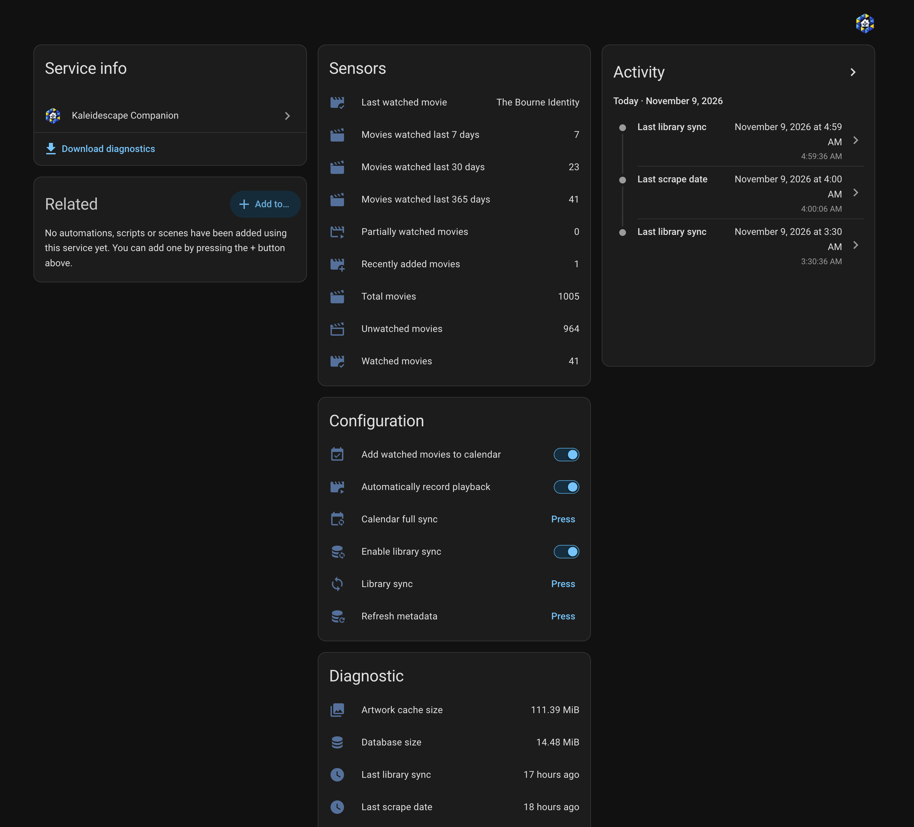

# Install and record your first viewing

Companion adds a shared Journal and optional Library to Home Assistant. This is
an unqualified development build preparing for alpha. The development baseline
is HA 2026.11.0 with pykaleidescape 1.2.0; an older or newer HA installation is
not automatically compatible. Supported releases, licensing and a public alpha
distribution are still [release work](development/roadmap.md#release-readiness).

## Prerequisites

- Administrator access to HA and its configuration directory, plus a usable
  backup before installing or upgrading.
- A complete built Companion directory from the chosen reviewed revision.
  Contributors can produce it with the
  [development commands](development/README.md).
- For automatic recording, HA's built-in **Kaleidescape** integration and three
  existing entities: a media player, its exact play-status sensor and its
  media-location sensor. Keep that integration installed.
- For Library, HA must reach the selected server's local browser interface.
  Recording and Library are independently enabled; player controls are optional.

HA does not need a source checkout, Python development tools, Node or Vite.
Companion includes its compiled panel, templates, branding and privately
namespaced patched pyk source. Do not replace HA's shared dependency or install
a global `/config/deps` overlay.

## Install the complete integration

1. Preserve a compatible backup of HA configuration and any existing Companion
   data. Use an isolated instance for initial qualification when practical.
2. Copy the complete built `custom_components/kaleidescape_companion/` directory
   into `<HA configuration>/custom_components/`. The final path must be
   `<HA configuration>/custom_components/kaleidescape_companion/manifest.json`.
   Do not copy just the Python files or nest the repository under that path.
3. Restart HA Core. Reloading the config entry does not replace imported Python
   modules after a code upgrade.
4. Choose **Settings → Devices & services → Add integration → Kaleidescape
   Companion**. Leave features disabled while reviewing setup.
5. Open **Kaleidescape Companion** in the sidebar, or `/kaleidescape-companion`
   on your HA origin. Review **Settings** as an administrator.

The integration creates one household entry. Removing and re-adding that entry
retains and reattaches its stored dataset. Built files contain five automation
blueprints; installing or updating a blueprint does not create or enable an HA
automation. See [automation setup](development/automations.md).

After configuration, the Companion service device groups sensors, feature
switches, job buttons and diagnostics. This example has recording, Library and
calendar features enabled; your values depend on your settings and history. See
[entities and automations](guides/entities-and-automations.md) for what each
control does.

## First useful action: record a viewing

In the integration's **Configure** flow, or Companion Settings, select
**Kaleidescape media player**, **Exact play-status sensor** and **Media-location
sensor**, then enable automatic tracking. For example, a fictional room might
use `media_player.cinema`, `sensor.cinema_play_status` and
`sensor.cinema_media_location`; choose the actual entities belonging to one
player in your HA installation.

Start playback normally on that player. Now Playing should reflect the selected
HA entities. Qualifying playback creates a Journal viewing; completion requires
the configured main-content time and a matching credits indication. The default
runtime cutoff ignores content shorter than ten minutes, and the default
completion threshold is five minutes of main-content playback. Pauses and scans
do not count as watched time. An early stop can remain partial.

Open **Journal** to review the result. See
[Journal and Library](guides/journal-and-library.md) for first sync, manual
viewings, corrections and recording recovery. A Library sync is required before
creating a manual viewing from an exact version with a known runtime.

## Enable other features deliberately

Library browsing, artwork, external metadata, calendar publishing, collection
changes and player controls have separate settings. Configuration and private
record management require administrator access. Active HA users can browse
enabled household data and use enabled playback controls. Basic/Advanced only
changes presentation; it does not grant permissions.

Use the [documentation index](README.md) for feature setup. Experimental title
launch does not guarantee an exact edition. Calendar Full Sync requires a
dedicated target because it can delete unmatched events. Receipt diagnostics
currently can include private email contents in HA logs; review the
[security guide](development/security.md#logging-diagnostics-and-dependency-review)
before enabling receipt imports.

## Upgrade, disable and recover

For an upgrade, back up first, replace the complete runtime directory, restart
HA and inspect the integration's status. Review **Settings → Automations** for
installed versus bundled blueprint versions and any proposed replacements.
Existing modified blueprints require review; code installation alone does not
replace them.

To stop recording, disable tracking; to stop new Library requests, disable
Library sync. Keep private data until you have confirmed the intended retention
or recovery action. See [troubleshooting](guides/troubleshooting.md) for
failures.

Code rollback is not database rollback. The first open of an older supported
database creates a pre-migration backup and upgrades transactionally. Earlier
code may reject the upgraded schema. Stop HA before restoring a compatible
database/configuration backup, preserve the current files, and account for
changes made since the backup. Never replace the live SQLite file. Detailed
backup, export and recovery constraints are in
[data management](development/data-management.md) and
[Journal storage](development/journal.md#exports-backups-and-restore).

The SSH [deployment helper](development/deployment.md) is an optional maintainer
utility. It is not required for installation, contribution or normal checks.
