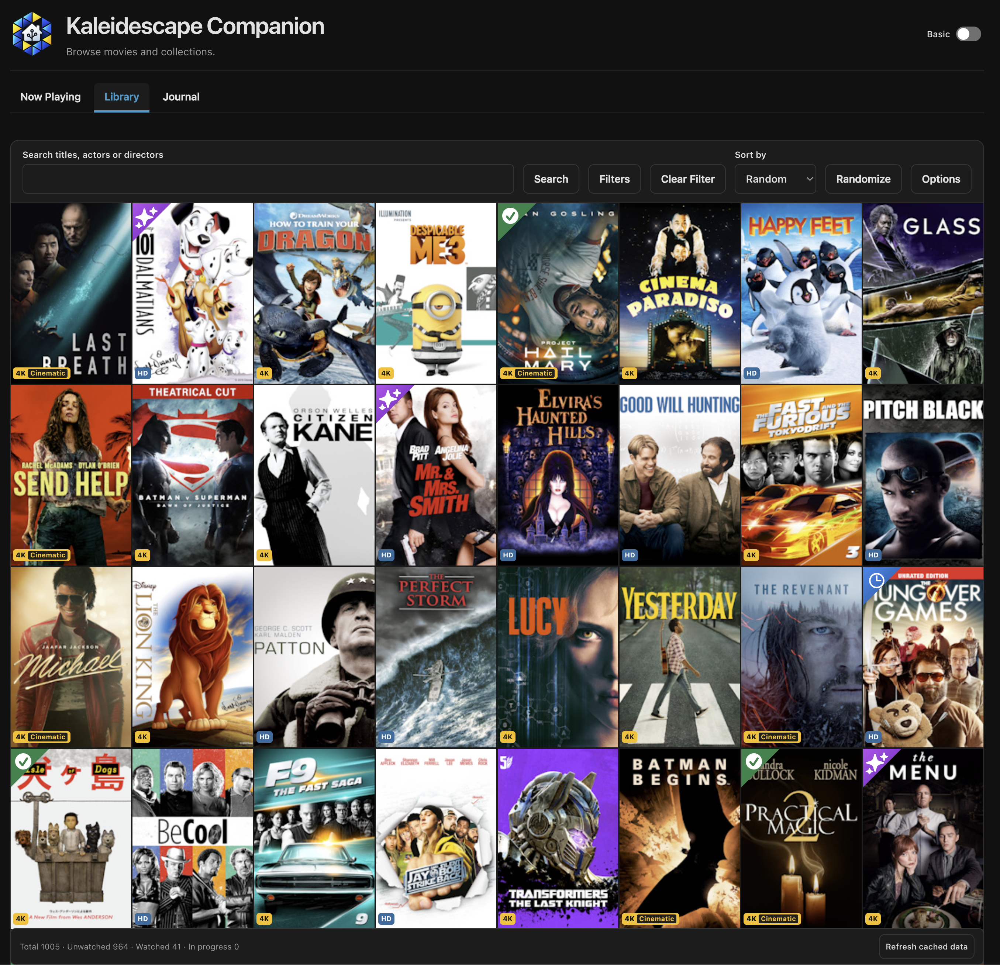
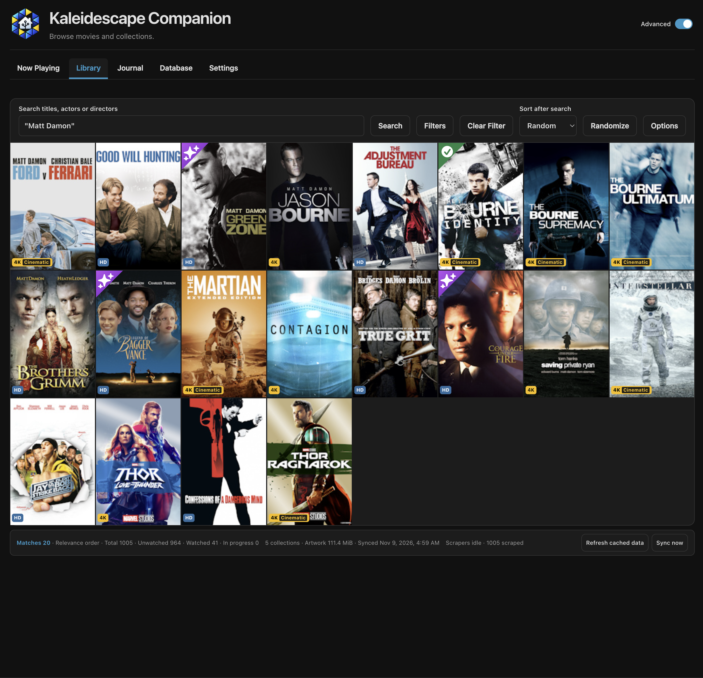
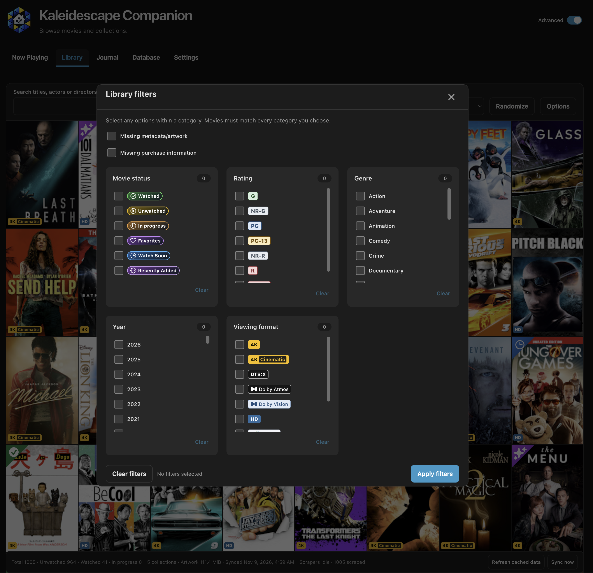
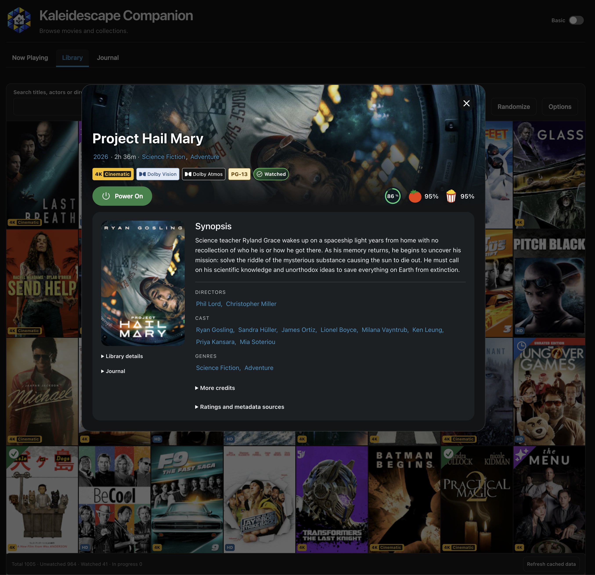
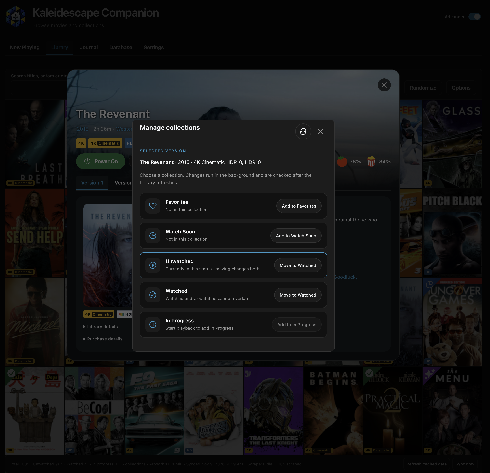

# Journal and Library

The Journal records viewings; Library is a cached catalog of versions on a
selected server. They keep separate identities and enablement. Administrators
configure them and edit records; active HA users browse enabled household
summaries. Private notes, purchases, exports and database tools have narrower
access. Start with [installation](../getting-started.md) if the panel is absent.

## Record and review playback

Select one existing HA media player and its distinct play-status and
media-location sensors, then enable tracking in Configure or Companion Settings.
Player-control selection does not change the recording source. Observation reads
HA states and does not send commands to the device.

Use **Now Playing** to check that the intended source is visible. During
eligible playback, watched time counts only the exact playing state; pauses,
scans and intermissions do not accrue time. A credits indication completes a
viewing only after the configured minimum main-content time. Missing runtime can
delay recording when the minimum-runtime filter is enabled.

Open **Journal** to browse the list or calendar. Search temporarily displays a
list; clearing it restores your selected view. **Today** returns the calendar to
the current month. A partial viewing may resume for the same player/content
within the configured window; a completed viewing followed by playback is a
rewatch. Same titles alone do not merge records.

If no viewing appears, confirm the three source entities, tracking state and
usable runtime before retrying playback. Interrupted observations preserve
recovery evidence rather than inventing time. Disabling tracking stops new
recording; restart/unload retains a checkpoint. See the
[recording reference](../development/journal.md#automatic-tracking) for exact
thresholds and recovery behavior.

## Sync the Library

1. As an administrator, open **Settings → Library**.
2. Enable Library sync. Leave **Kaleidescape Server Address** blank for
   `my-kaleidescape.local` discovery, or enter the selected server's private LAN
   hostname/origin, such as fictional `http://cinema-server.local`.
3. Choose whether to sync collections, details and cover artwork. Covers use a
   separate bounded disk cache; artwork is off by default.
4. Save and inspect the Library's sync status. Use **Sync now** for an explicit
   retry or later refresh. An active scan coalesces another sync request.

The first detail/artwork pass can take several minutes for a large catalog.
Successful sync produces locally browsable titles, grouped editions and
available metadata. Missing covers display placeholders. Browsing uses cached
data while the server is offline; a failed scan preserves prior data and does
not establish that it is current.

The Library cover view combines cached artwork, format badges and household
status. Open a cover to inspect its movie.

If discovery fails, verify that HA can resolve the server hostname and reach its
local browser interface. Only standard HTTP/HTTPS ports and private LAN
destinations are accepted; URLs containing credentials, paths or queries are
rejected. Password-protected or unrecognized pages are unsupported. Disable
Library sync to stop new connector activity.

Recurring sync uses an HA automation; there is no built-in periodic schedule.
Review the bundled Library sync blueprint under **Settings → Automations**, then
create and enable the desired automation in HA. See
[Library reference](../development/library.md) and
[automation setup](../development/automations.md).

## Find and inspect a movie

Enter a title, actor or director in the Library search box and choose
**Search**. Unquoted text allows partial matches and uses the shared
fuzzy-search setting. Put the whole query in double quotes for a whole-word
phrase, such as `"Matt Damon"` in the example below. Clearing the search
restores the selected sort and shuffle.

A quoted people search narrows the cached Library; the footer shows the match
count separately from catalog totals.

Choose **Filters** to narrow results by status, rating, genre, year or viewing
format. Several selections within one category match any selected value;
different categories must all match the same version. Choose **Apply filters**
to use the draft, or close with **X** to discard it. The toolbar's **Clear
Filter** clears search and filters while keeping your view, sort and page size.
The missing-data options shown below are administrator tools in Advanced view.

Filter categories combine to narrow the result. Applying the draft returns to
the first page.

Open a cover to read its synopsis, credits, ratings and available versions.
**Library details**, **Journal** and **Ratings and metadata sources** expand the
relevant information. A filtered movie can still show versions that did not
match the filter. Device controls appear only when enabled; use the
[player-control guide](player-controls.md) before sending a command.

The household movie dialog brings together Library facts and viewing history.
The Power On button shown here belongs to the separately enabled controls.

## Add or correct a viewing

After Library sync, an administrator in Advanced view can use **Add viewing** in
Journal, select the exact Library version with a known positive runtime and set
the local start time. Completed is the default; a partial entry needs positive
watched time within that runtime. The backend derives the title, identity and
end time from the chosen version and time values.

Open an existing viewing to review or correct supported fields. Corrections
preserve recorder evidence and protect manual choices from later recorder
updates. Deleting an entry hides it with a tombstone; it does not erase backups,
exports or retained recovery evidence. A stale revision means another change
won: refresh and review the current record before submitting again.

Manual entries can publish to a configured calendar, so use fictional records
only on an isolated instance with suitable feature settings. See
[data management](../development/data-management.md) for permanent
administration and [calendar behavior](../development/calendar.md) for external
publication and uncertainty recovery.

## Collection changes and uncertainty

Library sync does not enable device writes. **Allow collection changes** is a
separate administrator setting and requires collection sync. In Advanced view,
open a movie, select its exact version and choose **Collection**. For example,
**Add to Watch Soon** queues that version for the device collection. Favorites
and Watch Soon support add/remove; Watched and Unwatched are paired moves. In
Progress is created by playback and can only be removed here.

Check the selected version before choosing an action. Queued changes are
confirmed after a Library refresh.

Changes enter a durable queue. Refresh status after a lost response; do not
repeatedly submit the same external mutation. An uncertain outcome needs
readback/reconciliation before another write. The dialog's refresh icon reads
the selected version's membership from the device; it does not clear an
unconfirmed write. The [collection contract](../development/library.md) explains
supported moves, authorization checks and recovery limits.
