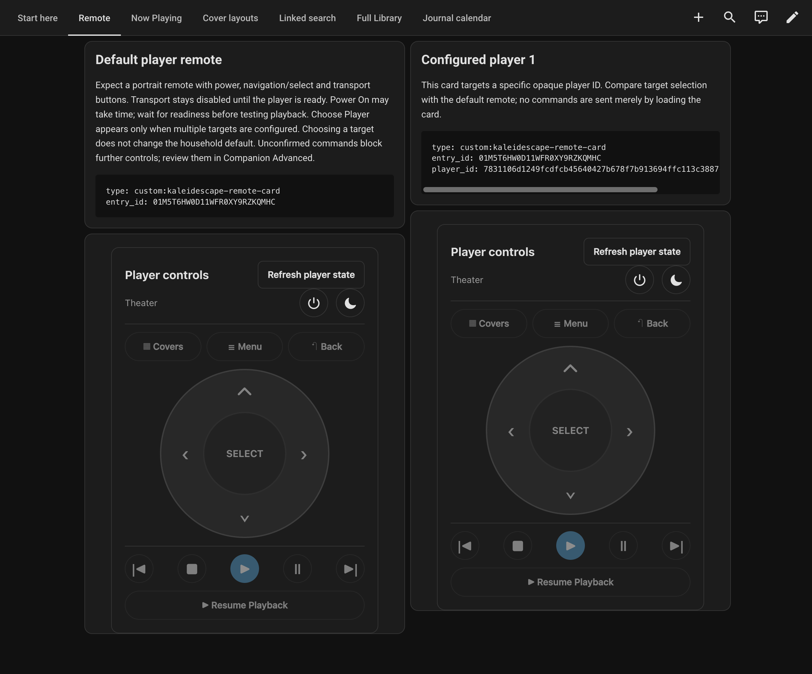

# Player controls

Companion can send remote commands and experimentally launch a Library title on
a selected Kaleidescape player. Controls are disabled by default. An
administrator configures them; once enabled, every active signed-in HA user can
use them. Commands run when clicked and can interrupt playback, put a player in
standby or trigger your theater's existing automation.

Keep HA's built-in Kaleidescape integration for playback observation. Companion
does not replace its media player. The control target and the player recorded by
the Journal are separate settings; choosing a remote target does not change the
recording source.

## Connect and choose a player

You need a movie-capable player reachable from HA on your trusted private LAN.
The local control interface uses TCP port 10000 without transport authentication
or encryption. Keep that interface on the trusted LAN.

1. As an administrator, open **Companion → Advanced → Settings → Playback**.
2. Turn on **Enable playback controls**. Enter the **Kaleidescape Player
   Address**, using a private LAN hostname or IP address. Blank uses the
   **Kaleidescape Server Address**, which itself defaults to
   `my-kaleidescape.local` when blank.
3. Save the connection, then choose **Discover devices**. Discovery reads the
   configured system without waking players; it does not scan your subnet.
4. Select a movie player as the default, then save again.
5. Leave **Allow Library title playback** off until you want to try the separate
   experimental launch workflow below.

Open **Now Playing → Player controls**, or add a
[remote dashboard card](dashboard-cards.md). Check the displayed player before
using a command. **Choose Player** changes the target of the current dialog or
card; it does not replace the shared default.

For a small first control check, use a player that is already playing something
you intend to pause. Select **Pause** once, inspect the physical player and HA's
playback observation, then select **Resume** when appropriate. A command result
acknowledges the request; observed player behavior is the confirmation that the
intended action happened. This guide does not report a completed hardware test.

## Use the remote or launch a title

The remote offers Play selection, Pause, Resume, Stop, Previous/Next chapter,
directions, Select, Back, Kaleidescape menu, Movie covers, Power on and Standby.
It does not automatically wake a player, retry a command or choose a replacement
player when your selected player is unavailable.

Dashboard remote examples for the default and an explicitly selected player.
Navigation and transport controls are disabled in this captured state.

Library launch also needs an enabled, synced Library and **Allow Library title
playback** enabled by an administrator. Open an available Library version and
choose **Play**. Purchase-only placeholders cannot be launched. Check the target
player in the dialog:

- **Check player** reads its state when it is unknown or starting.
- **Power On** explicitly wakes a player in standby or idle. Readiness checks
  can continue for up to two minutes. A connection reset during wake can defer
  the next read for 30 seconds.
- Once ready, choose **Play** again to launch. Becoming ready does not launch
  the movie automatically.

Companion checks the selected title and player before sending. The Library and
control connections must resolve to the same pinned system address. If it cannot
establish the title namespace, highlight that movie using the native player
interface and check again. It does not guess a title from a similar name.

The player chooses the playable format. Exact edition/format, resume versus
start-over, seeking and audio behavior are not qualified guarantees. A slow
start may be acknowledged before playback can be observed. Launching a title
does not itself create a completed Journal viewing; recording still depends on
the separately configured HA observation source.

## Recover from unavailable or unconfirmed controls

| Symptom                         | What to check                                                                                                                                                                   |
| ------------------------------- | ------------------------------------------------------------------------------------------------------------------------------------------------------------------------------- |
| No players discovered           | Save the connection first; verify HA can resolve the selected LAN hostname and reach TCP 10000. Discovery is bounded, so a partial result is not proof that a player is absent. |
| Default player offline          | Restore that player or explicitly choose another. Companion retains a known offline default instead of silently replacing it.                                                   |
| Library Play absent or rejected | Check both opt-ins, Library availability, the selected version and whether Library/control addresses identify the same system.                                                  |
| Player still starting           | Use **Check player** after waiting. Do not repeatedly send Power On or Play.                                                                                                    |
| Response lost                   | Use **Check command result**, which checks the same request, before issuing another command.                                                                                    |

If a command may have reached the player but no acknowledgement was received,
Companion marks it unconfirmed and blocks further writes to that player. An
administrator must inspect the actual player, then use **I inspected the
player…** to acknowledge the uncertainty. This permits a new command; it does
not resend the old one or prove that it failed. Do not edit protected command
receipts through Database tools to clear the barrier.

Restarting HA does not replay interrupted commands. To stop new control
requests, disable **Enable playback controls** and save. Disable **Allow Library
title playback** to stop launches while retaining the remote. A command already
accepted by the device can finish after a setting is disabled.

This remains a patched-pyk proof of concept. Automated checks cover fictional
devices and failure paths; real hardware, firmware behavior and native HA
coexistence still need operator qualification. See the
[control reference](../development/playback-controls.md) and
[pyk compatibility requirements](../development/pyk.md) for detailed limits.
